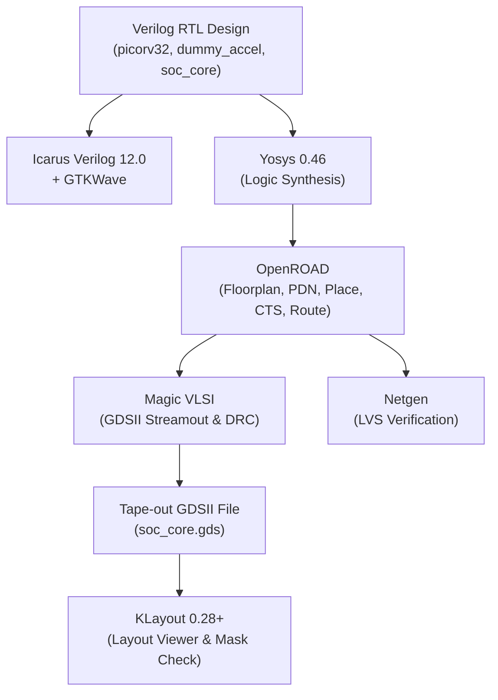

# EDA Toolchain & Open-Source Software Stack

This document details the complete Electronic Design Automation (EDA) toolchain, version specifications, and runtime environments used throughout the design, verification, and physical tape-out of the SoC.

---

## 1. Toolchain Hierarchy & Architecture

---

## 2. Tool Specifications

| Tool | Version / Release | Primary Responsibility | Input Formats | Output Formats |
|---|---|---|---|---|
| **Yosys** | `0.46` | Behavioral & RTL synthesis, technology mapping, netlist optimization | Verilog (`.v`, `.sv`) | Gate-level Verilog (`.v`), JSON netlist |
| **OpenROAD** | Integrated OL2 build | Floorplanning, I/O pin placement, Global Placement (RePlAce), Detailed Placement, Clock Tree Synthesis (TritonCTS), Detailed Routing (TritonRoute) | LEF, DEF, SDC, Liberty (`.lib`) | Placed & routed DEF |
| **Magic VLSI** | `8.3+` | Physical verification, GDSII layout streamout, Design Rule Checking (DRC) | DEF, Tech file (`sky130A.tech`) | GDSII (`.gds`), Extraction (`.ext`) |
| **Netgen** | `1.5+` | Layout Versus Schematic (LVS) comparison | SPICE (`.spice`), Verilog netlist | LVS report (`.lvs.rpt`) |
| **KLayout** | `0.28+` | High-performance mask visualizer, layer viewer | GDSII (`.gds`), OASIS | Visual layout inspection |
| **Volare** | Latest | Version manager for SkyWater PDKs | Git commit hash | PDK installation directory (`~/.volare`) |
| **Icarus Verilog** | `12.0` | IEEE 1364/1800 functional simulation | Verilog/SystemVerilog | VVP simulation binary, VCD waveform |
| **GTKWave** | `3.3+` | Waveform display & visual signal debugging | Value Change Dump (`.vcd`) | Waveform traces |

---

## 3. Containerized Runtime Environment

To eliminate host OS library incompatibilities, the entire physical flow is executed inside an official Nix-based Docker container:

- **Registry Image:** `ghcr.io/efabless/openlane2:2.3.10`
- **Container Architecture:** `x86_64` (Linux)
- **Base Management System:** Nix Flakes (Guarantees byte-for-byte reproducible tool builds)
- **Automation Runner:** GitHub Actions (`ubuntu-22.04` runner image)

