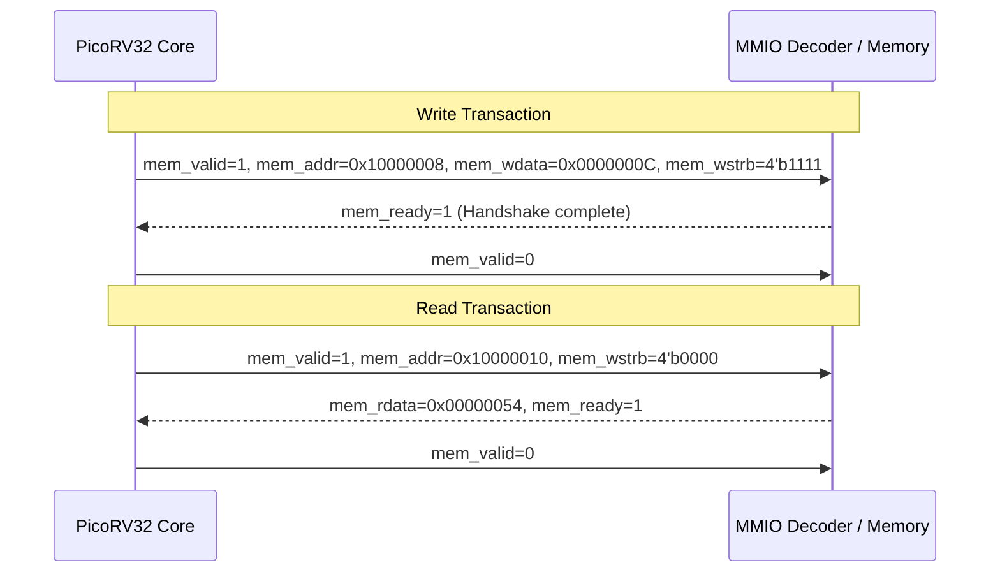

# PicoRV32 RISC-V IP Core Reference

**Author:** Clifford Wolf (Claire Wolf), YosysHQ GmbH  
**Repository:** [github.com/YosysHQ/picorv32](https://github.com/YosysHQ/picorv32)  
**License:** ISC License (Permissive open-source, commercially usable)  
**Architecture:** 32-bit RISC-V (RV32I / RV32E compatible)  

---

## 1. Overview & Architectural Features

PicoRV32 is a size-optimized, microcoded/state-machine-based implementation of the RISC-V RV32I instruction set architecture. It is designed specifically for embedded control, auxiliary SoC management, and resource-constrained FPGA/ASIC targets.

### Key Characteristics
- **Cycles Per Instruction (CPI):** Average $3.5 - 4.0$ cycles per instruction (balanced trade-off between silicon area and throughput).
- **Core Area:** Approximately $750 - 2000$ LUTs on modern FPGAs; $\approx 0.1\,\text{mm}^2$ on SkyWater 130nm standard cells.
- **Clock Frequency:** Verified up to $100\,\text{MHz}$ on SkyWater 130nm (50 MHz target used for conservative power/slack margins).

---

## 2. Configuration Parameters in `soc_core.v`

| Parameter | Value | Functional Rationale |
|---|---|---|
| `ENABLE_COUNTERS` | `1` | Enables hardware performance counters (`rdcycle`, `rdtime`, `rdinstret`) used for execution profiling. |
| `ENABLE_COUNTERS64` | `0` | Keeps counters 32-bit wide to minimize flip-flop gate count. |
| `ENABLE_REGS_16_31` | `1` | Full RV32I 32-register architecture (rather than 16-register RV32E). |
| `ENABLE_REGS_DUALPORT` | `0` | **Crucial for ASIC Synthesis:** Set to `0` to prevent multi-driven net errors during Yosys gate-level checks. |
| `LATCHED_MEM_RDATA` | `0` | Standard synchronous memory interface. |
| `TWO_STAGE_SHIFT` | `1` | Pipelined barrel shifter for improved timing closure at 50 MHz. |
| `BARREL_SHIFTER` | `0` | Sequential multi-cycle shift reduces combinational area. |
| `ENABLE_MUL` | `0` | **Hardware multiplier disabled in CPU** to demonstrate acceleration through the external MAC coprocessor. |
| `ENABLE_DIV` | `0` | Disabled to conserve silicon area. |
| `ENABLE_IRQ` | `0` | Polling MMIO mode used for accelerator synchronization. |
| `REGS_INIT_ZERO` | `1` | Guarantees all architectural registers reset cleanly to zero. |
| `PROGADDR_RESET` | `32'h0000_0000` | Vector address where instruction execution begins upon reset deassertion. |
| `STACKADDR` | `32'h0000_3FFC` | Initial stack pointer pointing to the top of 16 KB SRAM space. |

---

## 3. Bus Protocol (PicoRV32 Native Memory Interface)

The processor communicates with memory and peripherals using a simple, robust synchronous handshake:



- `mem_valid`: Asserted by the CPU when initiating a read or write transfer.
- `mem_instr`: High if transaction is an instruction fetch; low for data load/store.
- `mem_ready`: Asserted by peripheral when the transfer is finished.
- `mem_addr`: 32-bit byte address.
- `mem_wdata` / `mem_rdata`: 32-bit bidirectional data lines.
- `mem_wstrb`: 4-bit write strobe for byte-level masking (`4'b0000` designates a read transaction).

---

## 4. IP Licensing Notice
```
Copyright (C) 2015 Clifford Wolf <clifford@clifford.at>

Permission to use, copy, modify, and/or distribute this software for any
purpose with or without fee is hereby granted, provided that the above
copyright notice and this permission notice appear in all copies.
```
