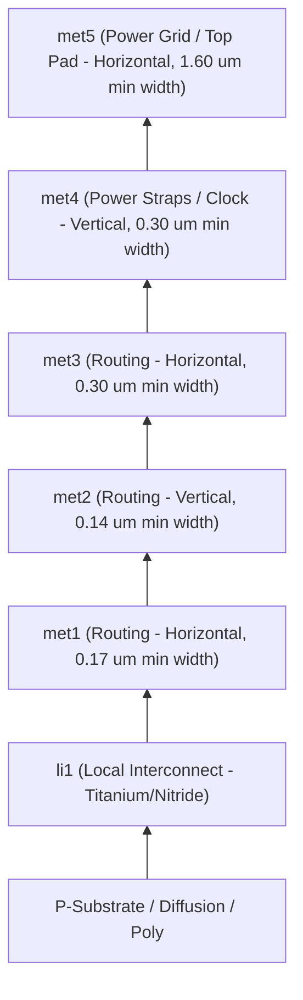

# SkyWater 130nm Standard Cell Library Reference (`sky130_fd_sc_hd`)

**Foundry:** SkyWater Technology Foundry (Minnesota, USA)  
**Process Node:** 130nm CMOS High-Density Process (PDK: `sky130A`)  
**Library Family:** `sky130_fd_sc_hd` (High Density, 7-track cell height)  
**Nominal Operating Voltage:** 1.8 V (VDD)  
**Substrate / Well:** P-substrate / N-well  

---

## 1. Physical Grid & Geometric Specifications

| Parameter | Value | Unit | Description |
|---|---|---|---|
| **Cell Height** | $2.72$ | $\mu\text{m}$ | 7 routing tracks at $0.46\,\mu\text{m}$ pitch ($2.72\,\mu\text{m} = 7 \times 0.388\,\mu\text{m}$ approx) |
| **Cell Width Unit (Pitch)** | $0.46$ | $\mu\text{m}$ | Standard placement grid pitch in horizontal X-direction |
| **Routing Layers** | 5 | layers | `met1`, `met2`, `met3`, `met4`, `met5` |
| **Local Interconnect (li1)**| 1 | layer | Sub-metal layer used within standard cells |
| **Substrate Voltage** | 0.0 (VSS) | V | Primary ground rail |
| **Well Voltage** | 1.8 (VDD) | V | Primary supply rail |

---

## 2. Metal Stack Definition

The SkyWater 130nm back-end-of-line (BEOL) metal stack consists of 5 copper/aluminum interconnect layers:

- **`met1` & `met2`**: Fine-pitch signal routing.
- **`met3`**: Long-distance signal routing and trunk clock trees.
- **`met4` & `met5`**: Power distribution network (PDN rings, VDD/VSS mesh stripes).

---

## 3. Key Standard Cell Types Used in `soc_core`

Our design maps to $14,832$ standard cells across several primary function classes:

### 3.1 Sequential Elements (Flip-Flops)
- **`sky130_fd_sc_hd__dfxtp_2`**: D-type flip-flop, positive-edge triggered, single non-inverted output Q, drive strength 2.
- **`sky130_fd_sc_hd__dfrtp_2`**: D-type flip-flop with asynchronous reset (active low).

### 3.2 Combinational Logic Elements
- **`sky130_fd_sc_hd__nand2_2` / `nand3_2`**: 2-input / 3-input NAND gate.
- **`sky130_fd_sc_hd__nor2_2` / `nor3_2`**: 2-input / 3-input NOR gate.
- **`sky130_fd_sc_hd__inv_2` / `inv_4`**: CMOS inverters (used for clock tree and signal buffering).
- **`sky130_fd_sc_hd__xnor2_2` / `xor2_2`**: 2-input XOR / XNOR gates (used extensively in multiplier adders).
- **`sky130_fd_sc_hd__mux2_2`**: 2-to-1 data multiplexer.

### 3.3 Complex / Compound Cells
- **`sky130_fd_sc_hd__a21o_2`**: AND-OR compound gate: $Y = (A_1 \cdot A_2) + B_1$.
- **`sky130_fd_sc_hd__a21oi_2`**: AND-OR-Invert gate: $Y = \overline{(A_1 \cdot A_2) + B_1}$.
- **`sky130_fd_sc_hd__o21a_2`**: OR-AND compound gate: $Y = (A_1 + A_2) \cdot B_1$.

---

## 4. Design Rule Check (DRC) & LVS Standards

- **DRC Engine:** Magic VLSI Layout System (`RUN_MAGIC_DRC`) & KLayout DRC.
- **LVS Engine:** Netgen (Layout vs. Schematic comparison against SPICE netlist).
- **Antenna Rules:** Diode insertion rules on long metal runs to protect thin gate oxides from plasma charge accumulation.

