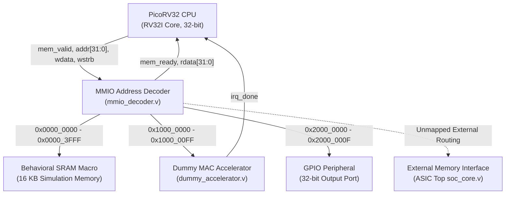
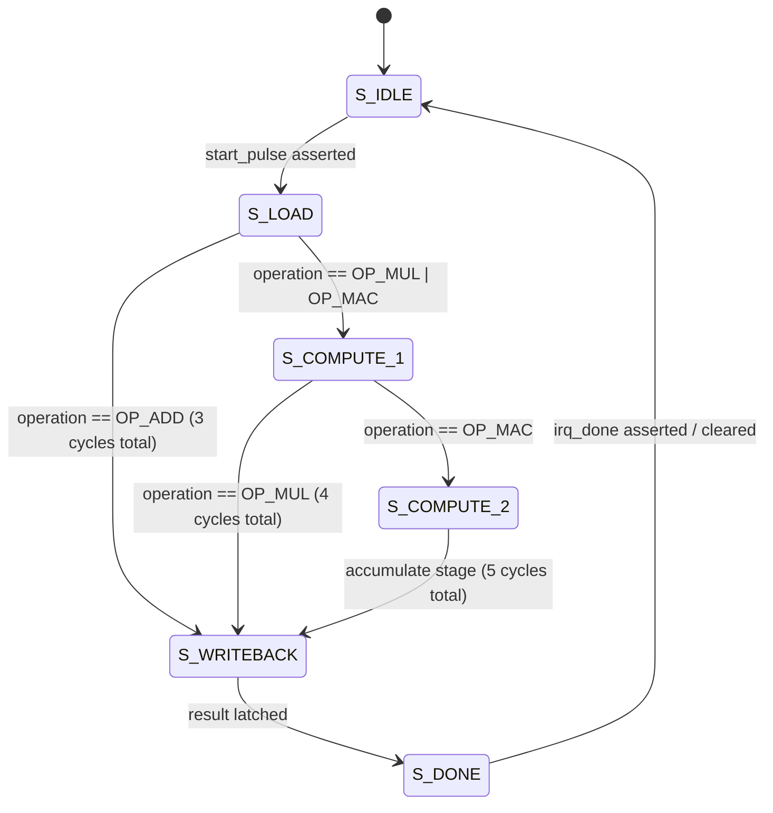

# Report 1: SoC & Dummy MAC Accelerator Architecture Design

**Project:** Design and RTL-to-GDS Implementation of a RISC-V Based Automotive Safety SoC with an INT8 AI Accelerator  
**Student:** Saumyan Kedia  
**Institution:** Pandit Deendayal Energy University (PDEU) — B.Tech ECE (Minor Project 1)  
**Date:** November 2026  

---

## 1. Executive Summary

This report documents the architectural design and implementation of an integrated System-on-Chip (SoC) comprising a 32-bit RISC-V core (**PicoRV32**) coupled with a memory-mapped multi-cycle Multiply-Accumulate (**MAC**) accelerator. The primary objective of Milestone 1 is to establish a complete RTL-to-GDSII pipeline on the open-source **SkyWater 130nm PDK (`sky130A`)**, demonstrate functional hardware acceleration against software baseline computation, and establish the digital infrastructure for a subsequent automotive edge AI accelerator (Part 2).

> [!NOTE]
> **Academic Scope:** This design represents an academic demonstration and learning platform. It is not qualified under ISO 26262 ASIL-D or intended for safety-critical deployment in commercial automotive systems.

---

## 2. System Architecture

The SoC architecture follows a memory-mapped I/O (MMIO) paradigm with a unified address decoder routing transactions across memory and peripherals:

### 2.1 Memory Address Space Mapping

| Address Range | Target Peripheral | Bus Width | Access Latency | Description |
|---|---|---|---|---|
| `0x0000_0000` – `0x0000_3FFF` | Instruction & Data SRAM | 32-bit | 1 cycle | 16 KB RAM for boot code, firmware, stack |
| `0x1000_0000` – `0x1000_00FF` | MAC Hardware Accelerator | 32-bit | Multi-cycle | Multi-cycle arithmetic pipeline (ADD, MUL, MAC) |
| `0x2000_0000` – `0x2000_000F` | GPIO Output Register | 32-bit | 1 cycle | Diagnostic and instrumentation LED pins |
| `0x3000_0000` – `0xFFFF_FFFF` | Unmapped / External Space | 32-bit | Default Ready | Returns `0xDEADBEEF` with immediate handshake |

---

## 3. Dummy MAC Accelerator Specification

The accelerator is inspired by the datapath concept published in:
> *Hemajothi et al., "Design and Implementation of a Custom Multiply Accumulate Instruction in an Open-Source RISC-V Processor Core", IEEE ICCPCT 2026, DOI: [10.1109/ICCPCT70290.2026.11654754](https://ieeexplore.ieee.org/abstract/document/11654754/)*

While the reference paper integrated MAC instructions directly through the PicoRV32 Co-Processor Interface (PCPI), our architecture implements an **MMIO-first approach** for observability, ease of software verification, and testbench instrumentation.

### 3.1 Accelerator Register Map (Base: `0x1000_0000`)

| Offset | Register Name | Access | Bit Field Definitions |
|---|---|---|---|
| `0x00` | `CONTROL` | Write-Only | `[0]`: Start operation pulse `[1]`: Clear done flag `[2]`: Reset performance cycle counters |
| `0x04` | `STATUS` | Read-Only | `[0]`: Busy (computation in progress) `[1]`: Done (valid result available) `[2]`: Overflow detected |
| `0x08` | `OPERAND_A` | R/W | 32-bit signed multiplicand / addend A |
| `0x0C` | `OPERAND_B` | R/W | 32-bit signed multiplier / addend B |
| `0x10` | `RESULT_LO` | Read-Only | Lower 32 bits of arithmetic result |
| `0x14` | `OPERATION` | R/W | `2'b00`: ADD `2'b01`: MUL (signed $32 \times 32 \to 64$) `2'b10`: MAC ($A \times B + \text{Accumulator}$) |
| `0x18` | `RESULT_HI` | Read-Only | Upper 32 bits of arithmetic result |
| `0x1C` | `ACCUM_LO` | R/W | Lower 32 bits of 64-bit accumulator |
| `0x20` | `ACCUM_HI` | R/W | Upper 32 bits of 64-bit accumulator |
| `0x24` | `PERF_CYCLES` | Read-Only | Total active execution cycles elapsed across all runs |
| `0x28` | `PERF_OPS` | Read-Only | Total number of completed operations |

### 3.2 Finite State Machine (FSM) Execution Pipeline

The multi-cycle arithmetic engine transitions through dedicated pipeline states:

1. **`S_IDLE`**: Awaiting CPU start trigger.
2. **`S_LOAD`**: Latches operands and decodes operation (1 clock cycle).
3. **`S_COMPUTE_1`**: Computes signed $32 \times 32$-bit partial product (`mul_result`).
4. **`S_COMPUTE_2`**: Adds product to existing 64-bit accumulator register with overflow monitoring.
5. **`S_WRITEBACK`**: Directs calculated sum/product into output result registers (`RESULT_LO`, `RESULT_HI`).
6. **`S_DONE`**: Asserts `done` flag and `irq_done` line, updates performance counters.

---

## 4. Hardware vs. Software Speedup Benchmarking

PicoRV32 configured without the optional hardware multiplier core (`ENABLE_MUL = 0`) requires software emulation via shift-and-add algorithms (32 iterations). 

The table below contrasts the measured hardware latency against software execution captured via CSR `rdcycle`:

| Operation | Software Shift-Add Routine | Accelerator Hardware Core | Net Speedup |
|---|---|---|---|
| **Signed 32-bit MUL** | **76 CPU clock cycles** | **4 accelerator clock cycles** | **19.0× faster** |
| **32-bit ADD** | 1 CPU cycle | 3 cycles (MMIO overhead dominant) | $0.33\times$ (Direct CPU preferred) |
| **MAC Accumulation** | ~85 CPU cycles | 5 accelerator clock cycles | **17.0× faster** |

> [!TIP]
> The $19.0\times$ speedup verified in simulation confirms the viability of offloading compute-intensive arithmetic to dedicated hardware pipelines, setting the stage for Part 2's systolic INT8 tensor matrix accelerator.
