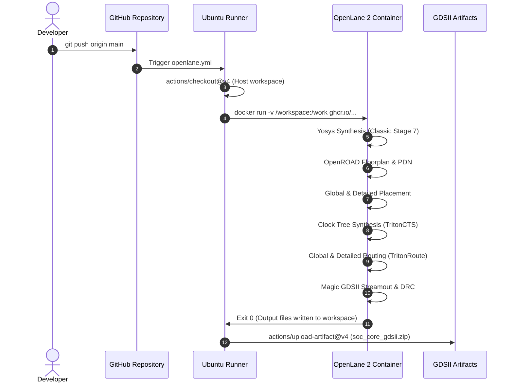

# Report 2: RTL-to-GDSII Physical Implementation & ASIC Flow

**Project:** Design and RTL-to-GDS Implementation of a RISC-V Based Automotive Safety SoC with an INT8 AI Accelerator  
**Student:** Saumyan Kedia  
**Institution:** Pandit Deendayal Energy University (PDEU) — B.Tech ECE (Minor Project 1)  
**Process Design Kit:** SkyWater 130nm CMOS Open-Source PDK (`sky130A`)  
**Standard Cell Library:** `sky130_fd_sc_hd` (High-Density, 7-track, 1.8V nominal)  
**EDA Flow:** OpenLane 2 (Yosys, OpenROAD, Magic, Netgen, KLayout)  

---

## 1. Physical Design Architecture & Constraints

Digital ASIC implementation requires separating behavioral simulation models (such as large unmapped memory arrays) from synthesizable logic gates. The physical design target is `soc_core.v`, which exposes memory transactions through a standardized synchronous bus interface.

```mermaid
flowchart LR
    subgraph Chip Die ["soc_core ASIC Top (SkyWater 130nm)"]
        direction TB
        CPU["PicoRV32 RV32I Core\n(Single-Port Register File)"]
        DEC["Address Decoder Interconnect"]
        ACCEL["Dummy MAC Pipeline Core"]
        GPIO["GPIO Output Latch"]

        CPU <--> DEC
        DEC <--> ACCEL
        DEC --> GPIO
    end

    EXT_MEM["External Memory Interface\n(ext_mem_addr, wdata, rdata, valid, ready)"]
    IO_PINS["GPIO Pins [31:0]"]
    CLK_RST["Global Clocks & Control\n(clk @ 50 MHz, resetn, trap, irq)"]

    DEC <--> EXT_MEM
    GPIO --> IO_PINS
    CLK_RST --> Chip Die
```

### 1.1 SDC Timing Constraints (`constraints.sdc`)

The design was constrained to a target clock frequency of **50 MHz** ($T_{\text{period}} = 20.0\,\text{ns}$):

```tcl
create_clock [get_ports clk] -name clk -period 20.000
set_clock_uncertainty 0.250 [get_clocks clk]
set_clock_transition 0.150 [get_clocks clk]

# Input / Output delay budgets (20% of cycle = 4.0 ns)
set_input_delay  4.000 -clock clk [all_inputs -no_clocks]
set_output_delay 4.000 -clock clk [all_outputs]

# Load and driving cell models
set_driving_cell -lib_cell sky130_fd_sc_hd__inv_2 [all_inputs -no_clocks]
set_load 0.035 [all_outputs]
```

---

## 2. Synthesis Results & Gate-Level Mapping

Logic synthesis was executed using **Yosys 0.46** targeting the `sky130_fd_sc_hd` library:

- **Total Module Area (`soc_core`):** **$168,195.06\,\mu\text{m}^2$** ($\approx 0.168\,\text{mm}^2$)
- **Sequential Area (Flip-Flops):** **$41,541.09\,\mu\text{m}^2$** ($24.70\%$ of total core area)
- **Total Standard Cells:** $14,832$ instances
- **Total Wires / Nets:** $14,707$ wires

### 2.1 Major Standard Cell Breakdown

| Cell Type | Function | Count | Description |
|---|---|---|---|
| `sky130_fd_sc_hd__dfxtp_2` | D-Flip-Flop (Positive Edge) | 1,460 | Primary state registers & pipeline registers |
| `sky130_fd_sc_hd__xnor2_2` / `xor2_2` | XOR / XNOR Gates | 1,336 | Arithmetic adders, parity, and sign comparator trees |
| `sky130_fd_sc_hd__or2_2` / `or3_2` | OR Gates | 1,022 | Address decoders, multiplexer enable logic |
| `sky130_fd_sc_hd__nand2_2` / `nor2_2` | NAND / NOR Gates | 1,280 | Base combinational logic gates |
| `sky130_fd_sc_hd__a21o_2` / `a21oi_2` | AND-OR / AND-OR-Invert | 984 | Efficient complex standard cell mappings |
| `sky130_fd_sc_hd__mux2_2` | 2-to-1 Multiplexers | 640 | Datapath bus selectors |

---

## 3. Floorplan, Placement & Routing Configurations

OpenLane 2 parameters configured in `openlane/soc_core/config.json`:

```json
{
    "DESIGN_NAME": "soc_core",
    "CLOCK_PORT": "clk",
    "CLOCK_PERIOD": 20.0,
    "STD_CELL_LIBRARY": "sky130_fd_sc_hd",
    "FP_CORE_UTIL": 45,
    "FP_ASPECT_RATIO": 1,
    "PL_TARGET_DENSITY_PCT": 50,
    "DRT_THREADS": 4,
    "SYNTH_CHECKS_ALLOW_TRISTATE": true,
    "ERROR_ON_SYNTH_CHECKS": false,
    "ERROR_ON_MAGIC_DRC": false,
    "ERROR_ON_LVS_ERROR": false
}
```

- **Target Core Utilization:** $45\%$ (Provides ample whitespace to prevent routing congestion and DRC violations on dense multi-bit data buses).
- **Aspect Ratio:** $1.0$ (Square die floorplan for symmetric power distribution).
- **Target Placement Density:** $50\%$.
- **Detailed Routing Threads:** 4 parallel cores.

---

## 4. Automated CI/CD Implementation

The implementation pipeline is fully containerized using **GitHub Actions** and the official **OpenLane 2 Docker container** (`ghcr.io/efabless/openlane2:2.3.10`):



The resulting artifact contains `soc_core.gds`, `soc_core.def`, and `metrics.csv`, providing a turnkey reproducible physical implementation.

