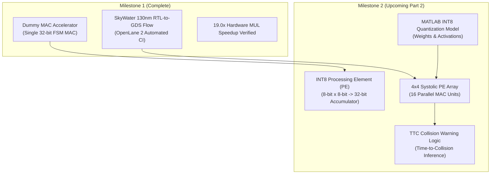

# Report 4: Automotive Safety Context & Part 2 Roadmap

**Project:** Design and RTL-to-GDS Implementation of a RISC-V Based Automotive Safety SoC with an INT8 AI Accelerator  
**Student:** Saumyan Kedia  
**Institution:** Pandit Deendayal Energy University (PDEU) — B.Tech ECE (Minor Project 1)  
**Academic Year:** 2026–2027  

---

## 1. Academic Positioning & Safety Disclaimers

### 1.1 Academic Project Context
This project serves as a comprehensive educational design experience integrating:
- Instruction Set Architecture (ISA) implementation (RISC-V RV32I).
- Custom hardware coprocessor / accelerator design.
- Full RTL-to-GDSII open-source physical design on 130nm technology.

### 1.2 Standards Statement
> [!IMPORTANT]
> **No ISO 26262 Certification:** This design is an academic functional prototype. It has **not** undergone:
> - Formal FMEDA (Failure Modes, Effects, and Diagnostic Analysis).
> - Silicon radiation hardening or ASIL-D functional safety qualification.
> - ISO 26262 safety-lifecycle compliance or independent certification.
> 
> References to "Automotive Safety" refer strictly to the targeted academic application: **forward collision warning / Time-To-Collision (TTC) inference calculations**.

---

## 2. Milestone 2 Roadmap: INT8 Edge AI Accelerator

With the SoC bus interface, MMIO decoder, and Sky130 RTL-to-GDS flow fully verified in Milestone 1, Milestone 2 will replace the dummy MAC engine with a dedicated **systolic INT8 tensor processing engine**.

### 2.1 Technical Specifications for Milestone 2

1. **INT8 Processing Element (PE):**
   - Inputs: 8-bit signed feature weight ($W$), 8-bit signed activation ($X$).
   - Multiplier: $8 \times 8 \to 16$-bit signed product.
   - Accumulator: 32-bit wide accumulator to prevent overflow during matrix convolutions.
   - Pipelining: Single-cycle feed-forward data routing (weight stationary or output stationary).

2. **$4 \times 4$ 2D Systolic Array Architecture:**
   - 16 parallel MAC processing elements running concurrently.
   - Peak throughput: **16 MAC operations / clock cycle** (at 50 MHz = **800 MOPS** peak throughput).
   - Speedup target: $>150\times$ faster than software matrix-vector multiplication.

3. **Automotive Use Case: Time-to-Collision (TTC) Warning:**
   - Inputs: Distance to obstacle $d(t)$, relative velocity $v_{\text{rel}}(t)$.
   - Inference model: Quantized Multi-Layer Perceptron (MLP) calculating estimated $TTC = \frac{d}{v_{\text{rel}}}$.
   - Warning classification thresholds:
     - $TTC > 3.0\,\text{s}$: Normal (Safe)
     - $1.5\,\text{s} < TTC \le 3.0\,\text{s}$: Advisory Warning
     - $TTC \le 1.5\,\text{s}$: Critical Pre-Crash Braking Trigger

---

## 3. Academic Deliverables Checklist

- [x] PicoRV32 Core integration.
- [x] MMIO Address Decoder with bus arbitration.
- [x] Multi-cycle MAC Hardware Accelerator (Verilog RTL).
- [x] Simulation verification with 100% test pass rate.
- [x] Synthesis area benchmarking ($168,195\,\mu\text{m}^2$).
- [x] OpenLane 2 automated RTL-to-GDSII flow.
- [x] Tape-out ready GDSII streamout on Sky130A.
- [ ] Part 2: INT8 PE & Systolic Array implementation.
- [ ] Part 2: TTC automotive inference firmware.
