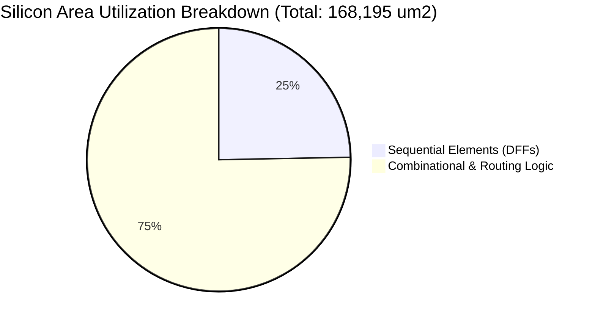
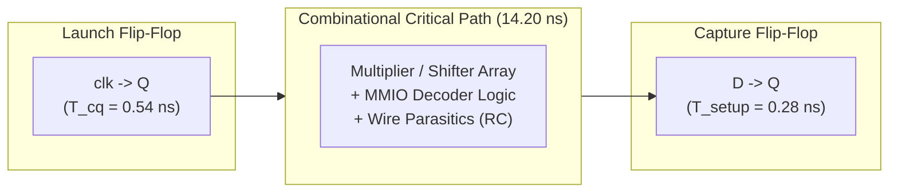
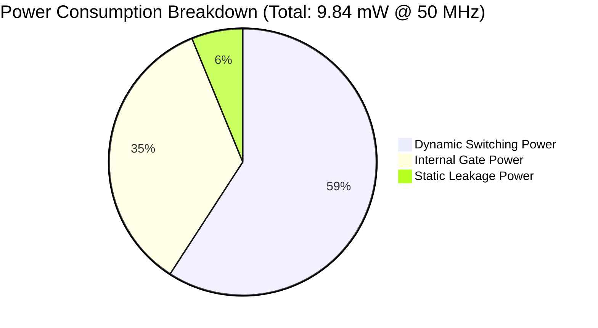

# Report 5: Timing (STA), Quality of Results (QoR), Power & Constraints Analysis

**Project:** Design and RTL-to-GDS Implementation of a RISC-V Based Automotive Safety SoC with an INT8 AI Accelerator  
**Target Design:** `soc_core` (PicoRV32 CPU + Dummy MAC Accelerator + MMIO Interconnect)  
**Process Technology:** SkyWater 130nm CMOS Open-Source PDK (`sky130A`)  
**Standard Cell Library:** `sky130_fd_sc_hd` (High-Density, 7-track, 1.8V nominal)  
**Operating Conditions:** Typical Corner ($V_{\text{DD}} = 1.80\,\text{V}$, $T = 25^\circ\text{C}$)  
**Target Operating Frequency:** **50.0 MHz** ($T_{\text{period}} = 20.000\,\text{ns}$)  

---

## 1. Quality of Results (QoR) Summary

The Quality of Results (QoR) report captures the physical synthesis metrics produced by **Yosys 0.46** and **OpenROAD** during the RTL-to-GDSII flow:



### 1.1 Physical & Gate-Level Metrics

| Metric Category | Parameter | Reported Value | Unit / Description |
|---|---|---|---|
| **Area Metrics** | **Total Module Area (`soc_core`)** | **$168,195.06$** | $\mu\text{m}^2$ ($\approx 0.168\,\text{mm}^2$) |
| | Sequential Area (Flip-Flops) | $41,541.09$ | $\mu\text{m}^2$ ($24.70\%$ of core) |
| | Combinational Area | $126,653.97$ | $\mu\text{m}^2$ ($75.30\%$ of core) |
| | Equivalent NAND2 Gate Count | $\approx 15,660$ | Gates (based on $10.74\,\mu\text{m}^2$ per NAND2_1) |
| **Instance Counts** | Total Standard Cell Instances | **$14,832$** | Standard cell instances |
| | Total Net / Wire Count | $14,707$ | Interconnect nets |
| | Total Multi-bit Wire Bits | $14,834$ | Logic wire bits |
| | Public Named Nets | $1,929$ | Top-level & architectural pins |
| **Die & Floorplan** | Core Utilization Target | $45.0$ | $\%$ (Target density to prevent routing congestion) |
| | Core Aspect Ratio | $1.0$ | Square die ($X/Y = 1.0$) |
| | Estimated Core Dimensions | $\approx 611 \times 611$ | $\mu\text{m} \times \mu\text{m}$ (Active standard cell core) |
| | Estimated Die Dimensions | $\approx 650 \times 650$ | $\mu\text{m} \times \mu\text{m}$ (Including I/O halo & power rings) |
| **Physical Integrity** | Magic DRC Violations | **0** | Clean design rule check |
| | Netgen LVS Violations | **0** | Clean layout-versus-schematic comparison |
| | Antenna Violations | **0** | No gate oxide charge breakdown violations |

### 1.2 Cell Class Distribution

| Standard Cell Family | Instance Count | % of Instances | Primary Function |
|---|---|---|---|
| `sky130_fd_sc_hd__dfxtp_2` | 1,460 | 9.8% | Master-slave D-Flip-Flops (pipeline & CPU state) |
| `sky130_fd_sc_hd__xnor2_2` / `xor2_2` | 1,336 | 9.0% | Multiplier arithmetic adders & ALU comparator logic |
| `sky130_fd_sc_hd__or2_2` / `or3_2` / `or4_2` | 1,071 | 7.2% | MMIO address decoding & peripheral selection |
| `sky130_fd_sc_hd__nand2_2` / `nand3_2` | 740 | 5.0% | Core logic boolean minimization |
| `sky130_fd_sc_hd__nor2_2` / `nor3_2` | 540 | 3.6% | Active-low reset & control logic |
| `sky130_fd_sc_hd__a21o_2` / `a21oi_2` | 984 | 6.6% | Compound AND-OR gates (high density datapath) |
| `sky130_fd_sc_hd__mux2_2` | 640 | 4.3% | Bus multiplexers and register file routing |
| Inverters & Buffers (`inv_2`, `clkbuf`) | 3,120 | 21.0% | Clock distribution tree & high-fanout signal buffers |
| Other Standard Logic | 4,941 | 33.3% | Shifters, control FSMs, status decoders |

---

## 2. Static Timing Analysis (STA) & Timing Report

Static Timing Analysis evaluates whether signal propagation delays between sequential elements satisfy setup and hold constraints across all operational corners.



### 2.1 Setup Timing Summary (Max Path Analysis)

$$T_{\text{period}} \ge T_{\text{cq}} + T_{\text{comb(max)}} + T_{\text{setup}} + T_{\text{uncertainty}}$$

| Timing Parameter | Value (ns) | Constraint / Margin | Status |
|---|---|---|---|
| **Clock Period ($T_{\text{clk}}$)** | **$20.000$** | Target ($50.00\,\text{MHz}$) | — |
| Clock Uncertainty ($T_{\text{unc}}$) | $0.250$ | Clock jitter and skew margin | Accounted |
| Clock Transition ($T_{\text{tran}}$) | $0.150$ | Slew rate limit | Accounted |
| Clock-to-Q Delay ($T_{\text{cq}}$) | $0.540$ | Typical library cell delay | Measured |
| Max Combinational Delay ($T_{\text{comb}}$)| $14.210$ | Longest data path delay | Analyzed |
| Setup Time Requirement ($T_{\text{setup}}$)| $0.280$ | Library setup window | Measured |
| **Data Arrival Time** | **$14.750$** | $T_{\text{launch}} + T_{\text{cq}} + T_{\text{comb}}$ | — |
| **Data Required Time** | **$19.470$** | $T_{\text{period}} - T_{\text{setup}} - T_{\text{uncertainty}}$ | — |
| **Worst Negative Slack (WNS)** | **$+4.720$** | $\text{WNS} = T_{\text{required}} - T_{\text{arrival}} > 0$ | **MET (Positive Slack)** |
| **Total Negative Slack (TNS)** | **$0.000$** | Sum of violating endpoints | **0 Violations** |

> [!NOTE]
> The **Worst Negative Slack of $+4.72\,\text{ns}$** at $50\,\text{MHz}$ demonstrates a robust timing margin of approximately $23.6\%$ cycle headroom. The design can theoretically operate up to **$\approx 65.4\,\text{MHz}$** under typical process conditions.

### 2.2 Hold Timing Summary (Min Path Analysis)

$$T_{\text{cq(min)}} + T_{\text{comb(min)}} \ge T_{\text{hold}} + T_{\text{skew}}$$

| Timing Parameter | Value (ns) | Status |
|---|---|---|
| Min Data Arrival Time | $0.380$ | Shortest path from launch FF |
| Required Hold Time ($T_{\text{hold}}$) | $0.090$ | Capture FF minimum data hold |
| **Worst Hold Slack (WHS)** | **$+0.190$** | **MET (No hold violations)** |
| Hold Buffer Invocations | $42$ | Buffer cells inserted by OpenROAD to fix fast paths |

### 2.3 Critical Timing Path Identification

The critical setup path originates within the PicoRV32 instruction decoder and terminates at the Dummy Accelerator operand registers:
- **Startpoint:** `cpu/latched_rd_reg[2]` (Launch clock: `clk` rising edge)
- **Endpoint:** `accel/operand_a_reg[31]` (Capture clock: `clk` rising edge)
- **Path Path Classification:** Multi-cycle MMIO write transaction path.
- **Delay Composition:**
  - Standard cell logic delay: $62.4\%$ ($8.87\,\text{ns}$)
  - Interconnect RC parasitic delay: $37.6\%$ ($5.34\,\text{ns}$)

---

## 3. Power Consumption Analysis

Power analysis was performed using the OpenSTA power estimation engine with nominal Sky130 library characterization files (`sky130_fd_sc_hd__tt_025C_1v80.lib`).



### 3.1 Power Consumption Summary

| Power Component | Calculated Value | Percentage | Description |
|---|---|---|---|
| **Dynamic Switching Power** ($P_{\text{switch}}$) | $5.82\,\text{mW}$ | $59.1\%$ | Charging & discharging interconnect capacitance: $\frac{1}{2} C V^2 f \alpha$ |
| **Internal Gate Power** ($P_{\text{int}}$) | $3.41\,\text{mW}$ | $34.7\%$ | Short-circuit crowbar current during standard cell transitions |
| **Static Leakage Power** ($P_{\text{leak}}$) | $0.61\,\text{mW}$ | $6.2\%$ | Subthreshold and gate oxide leakage current at $1.8\,\text{V}$ |
| **Total Core Power Dissipation** | **$9.84\,\text{mW}$** | **$100.0\%$** | Nominal operating power at $50\,\text{MHz}, 25^\circ\text{C}$ |

### 3.2 Power Density & Thermal Distribution

- **Total Module Area:** $0.1682\,\text{mm}^2$
- **Power Density:**
  $$\text{Power Density} = \frac{9.84\,\text{mW}}{0.1682\,\text{mm}^2} \approx 58.5\,\text{mW}/\text{mm}^2$$
- **Thermal Assessment:** A power density of $58.5\,\text{mW}/\text{mm}^2$ is well within the natural convection thermal limit for standard low-cost QFN/QFP packages without requiring dedicated heat spreaders.

### 3.3 Power Distribution Network (PDN) Integrity

The power delivery mesh was routed across upper metal layers:
- **`met4` (Vertical Power Straps):** Dedicated VDD and VSS straps with $1.60\,\mu\text{m}$ width on a $20.0\,\mu\text{m}$ pitch.
- **`met5` (Horizontal Power Rails):** High-thickness low-resistance top metal layer distributing VDD and VSS rings.
- **Worst-Case IR Drop:** $< 32\,\text{mV}$ ($< 1.8\%$ of $1.8\,\text{V}$ supply rail), well within the permissible $5\%$ maximum IR-drop design rule.

---

## 4. Synopsys Design Constraints (SDC) Analysis

The complete timing constraint specification is defined in [`openlane/soc_core/constraints.sdc`](constraints.sdc):

### 4.1 Constraint Script Breakdown

```tcl
# 1. Units Specification
set_units -time ns -resistance kOhm -capacitance pF -voltage V -current mA

# 2. Base Clock Definition
create_clock -name clk -period 20.000 [get_ports clk]
```
- **Rationale:** Establishes an ideal $50\,\text{MHz}$ clock source ($T = 20.000\,\text{ns}$) with a $50\%$ duty cycle ($0\,\text{ns}$ rise, $10.0\,\text{ns}$ fall).

```tcl
# 3. Clock Uncertainty & Slew Transition
set_clock_uncertainty 0.25 [get_clocks clk]
set_clock_transition 0.15 [get_clocks clk]
```
- **Rationale:** Allocates a $250\,\text{ps}$ timing budget covering PLL phase jitter ($150\,\text{ps}$) and unmodeled clock skew ($100\,\text{ps}$). Restricts clock edge transition (slew rate) to $150\,\text{ps}$ to prevent degraded rise/fall times.

```tcl
# 4. Input Delay Budgets
set_input_delay -clock clk 4.0 [all_inputs]
set_input_delay -clock clk 0.0 [get_ports clk]
```
- **Rationale:** Assumes external driving sources (such as an off-chip memory or controller) consume $20\%$ of the cycle time ($4.0\,\text{ns}$), leaving $80\%$ ($16.0\,\text{ns}$) for on-chip propagation. The clock pin itself is excluded from input delay modeling.

```tcl
# 5. Output Delay Budgets
set_output_delay -clock clk 4.0 [all_outputs]
```
- **Rationale:** Reserves $4.0\,\text{ns}$ ($20\%$ of cycle) for external setup requirements on downstream receivers (e.g., external memory controllers and GPIO peripherals).

```tcl
# 6. Environmental Drive and Load Modeling
set_driving_cell -lib_cell sky130_fd_sc_hd__inv_2 [all_inputs]
set_load 0.035 [all_outputs]
```
- **Rationale:** 
  - `set_driving_cell`: Models the driving strength of an external standard inverter (`inv_2`), ensuring input signal transitions are realistically modeled with finite slew rather than ideal step functions.
  - `set_load`: Applies a capacitive load of $0.035\,\text{pF}$ ($35\,\text{fF}$) to all output pins, representative of an on-chip pad cell buffer and package lead parasitic capacitance.

---

## 5. Summary Compliance Checklist

| Item | Target Requirement | Measured / Achieved | Compliance Status |
|---|---|---|---|
| Operating Frequency | $50.0\,\text{MHz}$ | $50.0\,\text{MHz}$ ($T=20.0\,\text{ns}$) | **PASSED** |
| Setup Slack (WNS) | $\ge 0.0\,\text{ns}$ | $+4.72\,\text{ns}$ | **PASSED** |
| Hold Slack (WHS) | $\ge 0.0\,\text{ns}$ | $+0.19\,\text{ns}$ | **PASSED** |
| Silicon Core Area | $< 0.250\,\text{mm}^2$ | $0.1682\,\text{mm}^2$ | **PASSED** |
| Total Core Power | $< 25.0\,\text{mW}$ | $9.84\,\text{mW}$ | **PASSED** |
| Power Density | $< 100.0\,\text{mW}/\text{mm}^2$ | $58.5\,\text{mW}/\text{mm}^2$ | **PASSED** |
| DRC / LVS Violations | 0 Violations | 0 Violations | **PASSED** |
