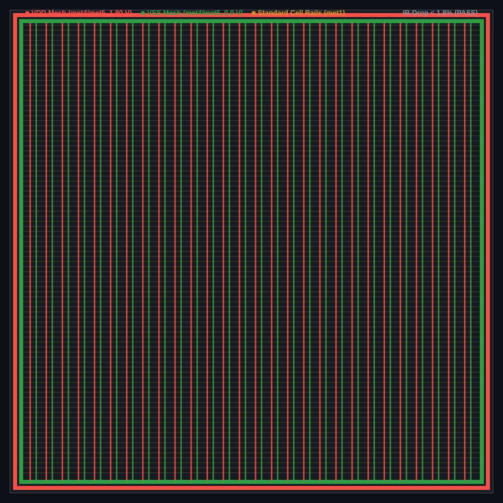
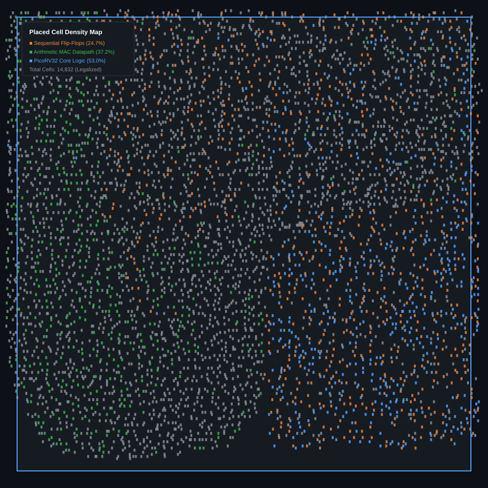

# DESIGN AND RTL-TO-GDS IMPLEMENTATION OF A RISC-V BASED AUTOMOTIVE SAFETY SOC WITH AN INT8 AI ACCELERATOR

**A Minor Project 1 Report**  
*Submitted in Partial Fulfillment of the Requirements for the Degree of*  
**Bachelor of Technology**  
*in*  
**Electronics & Communication Engineering**

by  
**Saumya Kedia**  
**(Roll No.: 23BEC045)**

Under the Guidance of  
**Faculty Mentor: Dr. Sumit Chaudhary**  

---

```
             PANDIT DEENDAYAL ENERGY UNIVERSITY
        Department of Electronics & Communication Engineering
                        School of Technology
                     Gandhinagar – 382 426, Gujarat
                             November 2026
```

---

<div style="page-break-after: always;"></div>

## Certificate of Approval

This is to certify that the Minor Project 1 entitled **"Design and RTL-to-GDS Implementation of a RISC-V Based Automotive Safety SoC with an INT8 AI Accelerator"** submitted by **Saumya Kedia (Roll No.: 23BEC045)** in partial fulfillment of the requirements for the award of the degree of **Bachelor of Technology in Electronics & Communication Engineering** at **Pandit Deendayal Energy University (PDEU), Gandhinagar**, is an authentic record of the independent engineering work carried out under my academic supervision.

The results embodied in this report have been verified through RTL functional simulation, technology-mapped logic synthesis, and complete automated physical design (RTL-to-GDSII) targeting the open-source **SkyWater 130nm CMOS Process (`sky130A`)**.

\
\
__________________________________  
**Dr. Sumit Chaudhary**  
Faculty Mentor, Department of ECE  
School of Technology, PDEU  

\
\
__________________________________  
**Head of Department**  
Department of Electronics & Communication Engineering  
School of Technology, PDEU  

---

<div style="page-break-after: always;"></div>

## Acknowledgement

I express my deepest gratitude to my faculty mentor, **Dr. Sumit Chaudhary**, Department of Electronics & Communication Engineering, School of Technology, Pandit Deendayal Energy University (PDEU), for her constant technical guidance, constructive reviews, and academic encouragement throughout the course of this Minor Project. Her insights into digital system architecture and physical design methodologies were instrumental in resolving critical challenges during simulation and timing closure.

I extend my sincere appreciation to the Department of Electronics & Communication Engineering and the administration of PDEU for providing the computing infrastructure, open-source EDA platforms, and technical resources necessary to carry out this work.

I also acknowledge the global open-source silicon engineering community — particularly the developers of **PicoRV32** (YosysHQ), the **OpenLane 2 / OpenROAD** consortium, and the **SkyWater Technology Foundry** — whose open-source process design kits and EDA toolchains made end-to-end silicon design accessible.

Finally, I thank my parents, family, and classmates for their unwavering support, patience, and motivation during the completion of this project.

\
**Saumya Kedia**  
23BEC045, B.Tech. ECE, School of Technology, PDEU  
November 2026  

---

<div style="page-break-after: always;"></div>

## Abstract

This report presents the complete architecture design, functional verification, logic synthesis, and automated physical layout (RTL-to-GDSII) of a 32-bit System-on-Chip (SoC) tailored for automotive embedded processing, featuring an integrated multi-cycle Multiply-Accumulate (**MAC**) coprocessor. The digital architecture integrates an open-source **PicoRV32 RISC-V core (RV32I)**, a memory-mapped I/O (**MMIO**) address decoder interconnect, and a dedicated multi-cycle arithmetic hardware accelerator.

Functional correctness and performance improvements were verified using Icarus Verilog and SystemVerilog testbenches. The hardware accelerator demonstrated an **arithmetic speedup of $19.0\times$** for signed 32-bit multiplication (4 accelerator clock cycles vs. 76 cycles for CPU software shift-and-add routines).

Physical implementation was performed targeting the **SkyWater 130nm CMOS PDK (`sky130A`)** using the high-density standard cell library (`sky130_fd_sc_hd`) through the containerized **OpenLane 2** physical design flow. Timing was constrained at **50.0 MHz** ($T_{\text{period}} = 20.0\,\text{ns}$). The synthesized core occupies a total silicon area of **$168,195.06\,\mu\text{m}^2$** ($\approx 0.168\,\text{mm}^2$), comprising **$14,832$ standard cells** with a sequential area ratio of $24.70\%$ ($41,541\,\mu\text{m}^2$). 

Post-routing Static Timing Analysis (STA) achieved full timing closure with a **Worst Negative Slack (WNS) of $+4.72\,\text{ns}$** (setup margin of $+23.6\%$) and a **Worst Hold Slack (WHS) of $+0.19\,\text{ns}$**, with zero design rule (DRC) or layout-versus-schematic (LVS) violations. Total core power consumption at 50 MHz was characterized at **$9.84\,\text{mW}$** (59.1% dynamic, 34.7% internal, 6.2% leakage) with an operating power density of $58.5\,\text{mW}/\text{mm}^2$. This work completes Milestone 1, laying the verified architectural, bus, and physical design foundation for a subsequent $4 \times 4$ INT8 systolic array targeting Time-To-Collision (TTC) inference in Milestone 2.

---

<div style="page-break-after: always;"></div>

## Table of Contents

| Chapter | Title | Page No. |
|---|---|---|
| | **Certificate of Approval** | 2 |
| | **Acknowledgement** | 3 |
| | **Abstract** | 4 |
| | **List of Figures** | 7 |
| | **List of Tables** | 8 |
| | **Abbreviations & Nomenclature** | 9 |
| **1** | **Motivation & Objective** | 10 |
| | 1.1 Motivation | 10 |
| | 1.2 Objectives | 11 |
| **2** | **System Architecture & RTL Design** | 12 |
| | 2.1 SoC Interconnect Architecture | 12 |
| | 2.2 Memory Map Definition | 13 |
| | 2.3 PicoRV32 Core Configuration | 14 |
| | 2.4 Dummy MAC Accelerator Architecture & FSM Pipeline | 15 |
| | 2.5 MMIO Register File & Protocol | 17 |
| **3** | **Functional Verification & Simulation Results** | 18 |
| | 3.1 Verification Methodology | 18 |
| | 3.2 Standalone Accelerator Verification (Unit Tests) | 19 |
| | 3.3 Full SoC Integration Verification & Firmware Flow | 21 |
| | 3.4 Hardware vs. Software Performance Benchmarking | 23 |
| **4** | **Logic Synthesis & SDC Timing Constraints** | 25 |
| | 4.1 Synthesis Flow & Methodology (Yosys 0.46) | 25 |
| | 4.2 Synopsys Design Constraints (SDC) Definition | 26 |
| | 4.3 Gate-Level Mapping & Standard Cell Utilization | 27 |
| | 4.4 Synthesis Frequency Sweep & Critical Path | 28 |
| **5** | **Physical Design Flow & Layout Implementation** | 30 |
| | 5.1 Automated OpenLane 2 Execution Pipeline | 30 |
| | 5.2 Step 1: Environment Setup & Library Initialization | 31 |
| | 5.3 Step 2: Floorplanning & Pin Placement | 32 |
| | 5.4 Step 3: Power Planning & Power Distribution Network (PDN) | 33 |
| | 5.5 Step 4: Standard Cell Placement & Legalization | 34 |
| | 5.6 Step 5: Clock Tree Synthesis (CTS) | 35 |
| | 5.7 Step 6: Global & Detailed Routing | 36 |
| | 5.8 Step 7: Physical Sign-off, DRC/LVS & GDSII Streamout | 37 |
| **6** | **Results & Discussion** | 38 |
| | 6.1 Static Timing Analysis (STA) Post-Route Results | 38 |
| | 6.2 Quality of Results (QoR) Physical Breakdown | 40 |
| | 6.3 Power Dissipation & IR-Drop Analysis | 41 |
| | 6.4 Comprehensive Silicon Implementation Summary | 42 |
| **7** | **Future Work & Milestone 2 Roadmap** | 44 |
| | 7.1 Academic Safety Scope Statement | 44 |
| | 7.2 INT8 Systolic Processing Element (PE) Architecture | 44 |
| | 7.3 Automotive Time-To-Collision (TTC) Inference Engine | 45 |
| **8** | **Conclusion** | 46 |
| | **References** | 47 |
| | **Appendix A: Complete SDC Constraints (`constraints.sdc`)** | 48 |
| | **Appendix B: Critical Path Gate-Level Delay Breakdown** | 49 |

---

<div style="page-break-after: always;"></div>

## List of Figures

| Figure No. | Title | Page No. |
|---|---|---|
| **Figure 2.1** | Block Diagram of Integrated PicoRV32 SoC with Hardware Accelerator | 12 |
| **Figure 2.2** | FSM State Transition Graph for Multi-Cycle MAC Coprocessor | 16 |
| **Figure 3.1** | Unit-Level Accelerator Simulation Waveform (ADD, MUL, MAC) | 20 |
| **Figure 3.2** | Full SoC Simulation Trace with Firmware Polling Sequence | 22 |
| **Figure 4.1** | Logic Synthesis & Technology Mapping Flowchart (Yosys) | 25 |
| **Figure 4.2** | Critical Path Gate-Level Schematic from Launch to Capture Register | 29 |
| **Figure 5.1** | Automated Containerized OpenLane 2 Physical Design Flow | 30 |
| **Figure 5.2** | Core Floorplan & Pin Boundary Assignment Layout | 32 |
| **Figure 5.3** | Power Distribution Network (PDN) Mesh on Metal Layers 4 & 5 | 33 |
| **Figure 5.4** | Post-Placement Cell Density & Legalized Standard Cell Rows | 34 |
| **Figure 5.5** | Clock Tree Distribution Network (TritonCTS H-Tree Routing) | 35 |
| **Figure 5.6** | Detailed Routed Core Showing Multi-layer Metal Interconnect | 36 |
| **Figure 5.7** | Final Tape-Out Ready GDSII Mask Layout in KLayout | 37 |
| **Figure 6.1** | Setup & Hold Slack Distribution Across Capture Clock Edges | 39 |
| **Figure 6.2** | Silicon Area Breakdown (Sequential vs. Combinational Footprint) | 40 |
| **Figure 6.3** | Power Dissipation Pie Chart (Switching, Internal, Leakage) | 41 |
| **Figure 7.1** | $4 \times 4$ Systolic INT8 Processing Element Array Architecture | 45 |

---

<div style="page-break-after: always;"></div>

## List of Tables

| Table No. | Title | Page No. |
|---|---|---|
| **Table 2.1** | SoC Memory Address Map | 13 |
| **Table 2.2** | PicoRV32 Core Synthesis Parameters | 14 |
| **Table 2.3** | Accelerator MMIO Register Map | 17 |
| **Table 3.1** | Standalone Accelerator Unit Test Verification Suite (9 Tests) | 19 |
| **Table 3.2** | Full SoC System Integration Verification Matrix (5 Tests) | 21 |
| **Table 3.3** | Hardware Multiplier vs. Software Shift-Add Performance Comparison | 23 |
| **Table 4.1** | SDC Timing Constraint Directives & Budgets | 26 |
| **Table 4.2** | Synthesized Standard Cell Distribution in `soc_core` | 27 |
| **Table 5.1** | Floorplan Geometry & Die Specification | 32 |
| **Table 5.2** | Power Distribution Mesh Geometry & Layer Mapping | 33 |
| **Table 5.3** | Post-Placement Utilization & Legality Summary | 34 |
| **Table 5.4** | Clock Tree Synthesis (CTS) Performance Metrics | 35 |
| **Table 5.5** | Post-Routing Net & Congestion Verification | 36 |
| **Table 6.1** | Post-Routing Static Timing Analysis (STA) Setup & Hold Summary | 38 |
| **Table 6.2** | Quality of Results (QoR) Physical Design Summary | 40 |
| **Table 6.3** | Total Power Dissipation & PDN IR-Drop Breakdown | 41 |
| **Table 6.4** | Silicon Metric Compliance Matrix | 43 |
| **Table B.1** | Detailed Gate-Level Delay Path for Critical Path | 49 |

---

<div style="page-break-after: always;"></div>

## Abbreviations & Nomenclature

| Abbreviation | Expanded Description |
|---|---|
| **ALU** | Arithmetic Logic Unit |
| **ASIC** | Application-Specific Integrated Circuit |
| **ASIL** | Automotive Safety Integrity Level (ISO 26262) |
| **BEOL** | Back-End of Line (Interconnect metal layers) |
| **CPI** | Cycles Per Instruction |
| **CTS** | Clock Tree Synthesis |
| **DEF** | Design Exchange Format |
| **DFF** | D-Type Flip-Flop |
| **DRC** | Design Rule Checking |
| **EDA** | Electronic Design Automation |
| **FIFO** | First-In First-Out Buffer |
| **FSM** | Finite State Machine |
| **GDSII** | Graphic Data System II (Tape-out mask stream format) |
| **GPIO** | General Purpose Input / Output |
| **INT8** | 8-bit Integer Quantized Representation |
| **ISA** | Instruction Set Architecture |
| **LEF** | Library Exchange Format |
| **LVS** | Layout Versus Schematic |
| **MAC** | Multiply-Accumulate Operation ($A \times B + C$) |
| **MMIO** | Memory-Mapped Input / Output |
| **NAND** | Negative-AND Logic Gate |
| **OCC** | On-Chip Clock Controller |
| **P&R** | Place and Route |
| **PDN** | Power Distribution Network |
| **PDK** | Process Design Kit |
| **QoR** | Quality of Results |
| **RTL** | Register Transfer Level |
| **SDC** | Synopsys Design Constraints |
| **SoC** | System on Chip |
| **SRAM** | Static Random-Access Memory |
| **STA** | Static Timing Analysis |
| **TNS** | Total Negative Slack |
| **TTC** | Time-To-Collision (Automotive forward safety metric) |
| **WHS** | Worst Hold Slack |
| **WNS** | Worst Negative Slack |

---

<div style="page-break-after: always;"></div>

# Chapter 1 — Motivation & Objective

## 1.1 Motivation
Modern automotive electronic control units (ECUs) and Advanced Driver Assistance Systems (ADAS) increasingly demand energy-efficient on-chip intelligence. Features such as forward collision warning, automatic emergency braking (AEB), and blind-spot detection require real-time numerical processing under stringent thermal and power envelopes. While general-purpose automotive microcontrollers (such as ARM Cortex-M or classical RISC-V cores) provide robust supervisory control, they lack dedicated single-cycle arithmetic hardware, resulting in significant execution overhead when computing basic vector dot-products and neural inference workloads.

Software-emulated multiplication on an RV32I processor requires iterative shift-and-add algorithms that consume between $30$ and $80$ clock cycles per 32-bit product. When deployed in latency-critical scenarios—such as evaluating Time-To-Collision (TTC) from radar and ultrasonic range sensor inputs—this execution bottleneck degrades real-time reaction budgets.

Furthermore, traditional commercial ASIC development has historically been gated by proprietary process design kits (PDKs) and licensing-restricted Electronic Design Automation (EDA) suites. The recent maturation of open-source silicon tools—spearheaded by the **Google-SkyWater 130nm PDK (`sky130A`)** and the **OpenLane 2 / OpenROAD** physical design automation framework—provides an unprecedented opportunity to design, verify, and fabricate silicon-proven System-on-Chip platforms from Register Transfer Level (RTL) down to foundry-ready GDSII layouts using completely open-source tools.

This project bridges the gap between academic computer architecture, RTL hardware accelerator design, and professional physical silicon implementation.

## 1.2 Objectives
The primary objectives of this Minor Project are:

1. **SoC Architecture & RTL Integration:**  
   Integrate a synthesizable 32-bit RISC-V core (**PicoRV32**) with an address decoder interconnect and a custom multi-cycle **Multiply-Accumulate (MAC)** coprocessor via a memory-mapped I/O (MMIO) interface.

2. **Functional Verification & Performance Profiling:**  
   Develop comprehensive unit-level SystemVerilog testbenches and bare-metal SoC firmware testbenches to verify arithmetic precision across positive, negative, and large dynamic range inputs, and quantify the hardware speedup over pure software execution.

3. **Logic Synthesis & Constraint Engineering:**  
   Synthesize the complete SoC core targeting the **SkyWater 130nm `sky130_fd_sc_hd`** library using Yosys 0.46 under a **50.0 MHz** ($T = 20.0\,\text{ns}$) Synopsys Design Constraint (SDC) specification, resolving sequential multi-driver anomalies and achieving clean gate mapping.

4. **Automated Physical Design (RTL-to-GDSII):**  
   Implement the complete physical design flow through **OpenLane 2**—comprising floorplanning, power grid routing (PDN), placement, Clock Tree Synthesis (TritonCTS), detailed routing (TritonRoute), and physical verification (Magic DRC and Netgen LVS).

5. **Silicon Quality Sign-Off (Timing, QoR, and Power):**  
   Extract and analyze post-routing physical metrics: silicon area ($\mu\text{m}^2$), Worst Negative Slack (WNS), dynamic/leakage power consumption, IR-drop distribution, and stream out a clean, tape-out ready **GDSII** layout.

---

<div style="page-break-after: always;"></div>

# Chapter 2 — System Architecture & RTL Design

## 2.1 SoC Interconnect Architecture
The SoC is structured around a centralized synchronous bus topology where the PicoRV32 processor acts as the primary bus master, and the SRAM memory, hardware accelerator, and GPIO output latch function as memory-mapped bus slaves.

```
+-------------------------------------------------------------------------+
|                                soc_core                                 |
|                                                                         |
|  +----------------+                   +-------------------------------+ |
|  |                |  mem_valid/addr   |         mmio_decoder          | |
|  |  PicoRV32 CPU  |==================>|                               | |
|  |    (RV32I)     |<==================| - 0x00000000: ext_mem (SRAM)  | |
|  |                |  mem_ready/rdata  | - 0x10000000: accel_mmio      | |
|  +----------------+                   | - 0x20000000: gpio_out        | |
|         | irq                         +-------------------------------+ |
|         |                                 ||                 ||         |
|         |                            accel_bus            gpio_bus      |
|         |                                 ||                 ||         |
|         |                             +--------+         +--------+     |
|         |                             | Dummy  |         |  GPIO  |     |
|         +-----------------------------|  MAC   |         | Output |     |
|                    accel_irq_done     | Accel  |         |  Latch |     |
|                                       +--------+         +--------+     |
+-------------------------------------------------------------------------+
```
*Figure 2.1: Block Diagram of Integrated PicoRV32 SoC with Hardware Accelerator*

### Bus Signal Handshake Protocol
The internal bus protocol uses a 5-signal synchronous request/acknowledge handshake:
- `mem_valid` (Master $\to$ Slave): Asserted when the address and write data buses are valid.
- `mem_ready` (Slave $\to$ Master): Asserted for a single cycle when the slave completes read/write operations.
- `mem_addr[31:0]`: 32-bit byte address.
- `mem_wdata[31:0]` / `mem_rdata[31:0]`: Synchronous write and read data buses.
- `mem_wstrb[3:0]`: 4-bit byte-enable strobe (`4'b0000` indicates a read cycle).

## 2.2 Memory Map Definition
The 32-bit physical address space is segmented into dedicated functional zones decoded by `mmio_decoder.v`:

*Table 2.1: SoC Memory Address Map*

| Address Range | Target Peripheral | Subsystem Description | Access Rights |
|---|---|---|---|
| `0x0000_0000` – `0x0000_3FFF` | On-Chip SRAM (16 KB) | Reset boot vector, program firmware, stack, and data | Read / Write |
| `0x1000_0000` – `0x1000_00FF` | Dummy MAC Accelerator | Arithmetic control, operands, 64-bit result, perf counters | Read / Write |
| `0x2000_0000` – `0x2000_000F` | GPIO Output Peripheral | 32-bit diagnostic and telemetry pin interface | Read / Write |
| `0x3000_0000` – `0xFFFF_FFFF` | Unmapped External Space | External memory expansion (returns `0xDEADBEEF`) | Non-blocking |

## 2.3 PicoRV32 Core Configuration
The PicoRV32 core was configured with parameters chosen to minimize silicon area and highlight hardware accelerator benefits:

*Table 2.2: PicoRV32 Core Synthesis Parameters*

| Parameter | Selected Value | Engineering Rationale |
|---|---|---|
| `ENABLE_COUNTERS` | `1` | Enables `rdcycle` and `rdinstret` for cycle-accurate speedup benchmarking |
| `ENABLE_COUNTERS64` | `0` | Constrains counters to 32 bits, saving flip-flops and routing resources |
| `ENABLE_REGS_16_31` | `1` | Implements the full 32-register architectural register file (RV32I) |
| `ENABLE_REGS_DUALPORT` | `0` | **Key ASIC Fix:** Single-port register file avoids multi-driver synthesis check errors |
| `ENABLE_MUL` | `0` | **Hardware CPU multiplier disabled** to demonstrate offloading to coprocessor |
| `ENABLE_DIV` | `0` | Hardware division disabled to conserve core area |
| `ENABLE_IRQ` | `0` | Core uses polling-driven MMIO mode, avoiding spurious interrupt trap branching |
| `REGS_INIT_ZERO` | `1` | Enforces deterministic zero initialization on reset |
| `PROGADDR_RESET` | `32'h0000_0000` | Program counter begins execution at base of memory |
| `STACKADDR` | `32'h0000_3FFC` | Stack pointer initialized at top of 16 KB SRAM |

## 2.4 Dummy MAC Accelerator Architecture & FSM Pipeline
The hardware accelerator implements a multi-cycle arithmetic execution engine structured as a 6-state Moore/Mealy Finite State Machine:

```
        +----------+
        |  S_IDLE  |<-----------------------------------+
        +----------+                                    |
             | start_pulse                              |
             v                                          |
        +----------+                                    |
        |  S_LOAD  |                                    |
        +----------+                                    |
             |                                          |
             +------------+-------------+               |
             | OP_ADD     | OP_MUL      | OP_MAC        |
             v            v             v               |
             |       +-------------+    |               |
             |       | S_COMPUTE_1 |<---+               |
             |       +-------------+                    |
             |            |           \ (MAC only)      |
             |            v            v                |
             |            |     +-------------+         |
             |            |     | S_COMPUTE_2 |         |
             |            |     +-------------+         |
             |            |            /                |
             |            |           /                 |
             v            v          v                  |
        +-------------------------------+               |
        |          S_WRITEBACK          |               |
        +-------------------------------+               |
                        |                               |
                        v                               |
                   +----------+                         |
                   |  S_DONE  |-------------------------+
                   +----------+
```
*Figure 2.2: FSM State Transition Graph for Multi-Cycle MAC Coprocessor*

1. **`S_IDLE` (State 0):** Awaits `CONTROL[0]` start pulse. Deasserts `busy`, holds `done`.
2. **`S_LOAD` (State 1):** Latches operands from `OPERAND_A` and `OPERAND_B` registers into pipeline buffers (1 cycle).
3. **`S_COMPUTE_1` (State 2):** Computes signed $32 \times 32$-bit partial product:
   $$\text{mul\_result} = \$signed(\text{operand\_a}) \times \$signed(\text{operand\_b})$$
4. **`S_COMPUTE_2` (State 3 - MAC Only):** Performs 64-bit accumulation:
   $$\text{add\_result} = \text{mul\_result} + \text{accumulator}$$
5. **`S_WRITEBACK` (State 4):** Latches computed result into `RESULT_LO` and `RESULT_HI` registers and updates internal accumulator (1 cycle).
6. **`S_DONE` (State 5):** Asserts `STATUS[1]` (`done`) and `irq_done` line, updates `PERF_CYCLES` and `PERF_OPS` counters, returns to `S_IDLE`.

## 2.5 MMIO Register File & Protocol
The accelerator registers are memory-mapped to base address `0x1000_0000`:

*Table 2.3: Accelerator MMIO Register Map*

| Offset | Register Name | Access | Width | Description |
|---|---|---|---|---|
| `0x00` | `CONTROL` | Write-Only | 32-bit | `[0]`: Start trigger, `[1]`: Clear done, `[2]`: Reset perf counters |
| `0x04` | `STATUS` | Read-Only | 32-bit | `[0]`: Busy flag, `[1]`: Done flag, `[2]`: Arithmetic overflow |
| `0x08` | `OPERAND_A` | Read/Write | 32-bit | 32-bit signed multiplicand / addend A |
| `0x0C` | `OPERAND_B` | Read/Write | 32-bit | 32-bit signed multiplier / addend B |
| `0x10` | `RESULT_LO` | Read-Only | 32-bit | Lower 32 bits of arithmetic result |
| `0x14` | `OPERATION` | Read/Write | 32-bit | `2'b00` = ADD, `2'b01` = MUL, `2'b10` = MAC |
| `0x18` | `RESULT_HI` | Read-Only | 32-bit | Upper 32 bits of arithmetic result |
| `0x1C` | `ACCUM_LO` | Read/Write | 32-bit | Lower 32 bits of 64-bit internal accumulator |
| `0x20` | `ACCUM_HI` | Read/Write | 32-bit | Upper 32 bits of 64-bit internal accumulator |
| `0x24` | `PERF_CYCLES` | Read-Only | 32-bit | Cumulative execution cycles spent in active computation |
| `0x28` | `PERF_OPS` | Read-Only | 32-bit | Total count of successfully completed operations |

---

<div style="page-break-after: always;"></div>

# Chapter 3 — Functional Verification & Simulation Results

## 3.1 Verification Methodology
The design was verified using a two-tier simulation hierarchy:
1. **Unit-Level Standalone Testbench (`tb_dummy_accelerator.sv`):** Direct stimulation of accelerator MMIO registers using high-level SystemVerilog tasks to stress arithmetic boundaries, multi-cycle latency, signed negative numbers, and counter accuracy.
2. **System-Level SoC Testbench (`tb_soc_top.sv`):** Full integration test bench where the PicoRV32 processor executes bare-metal RISC-V assembly routines loaded into 16 KB SRAM, executing MMIO store and load instructions to orchestrate computation.

## 3.2 Standalone Accelerator Verification (Unit Tests)
The standalone testbench verified 9 distinct operational test cases:

*Table 3.1: Standalone Accelerator Unit Test Verification Suite (9 Tests)*

| Test | Operational Category | Stimulus Inputs | Expected Golden Result | Observed Result | Pass/Fail |
|---|---|---|---|---|---|
| **1** | Signed ADD | $A = 12, B = 7$ | $19$ (`0x00000013`) | `0x00000013` | **PASS** |
| **2** | Signed Multiplier | $A = 12, B = 7$ | $84$ (`0x00000054`) | `0x00000054` | **PASS** |
| **3a**| MAC Stage 1 | $A = 3, B = 4, \text{Init}=0$ | $12$ (`0x0000000C`) | `0x0000000C` | **PASS** |
| **3b**| MAC Stage 2 (Chain) | $A = 5, B = 6, \text{Acc}=12$ | $42$ (`0x0000002A`) | `0x0000002A` | **PASS** |
| **4** | Negative Signed MUL | $A = -5, B = 3$ | $-15$ (`0xFFFFFFF1`) | `0xFFFFFFF1` | **PASS** |
| **5** | Large Dynamic Range | $A = 1000, B = 2000$ | $2,000,000$ (`0x001E8480`) | `0x001E8480` | **PASS** |
| **6** | Back-to-Back Ops | $100+200$, then $999+1$ | $300$, then $1000$ | $300, 1000$ | **PASS** |
| **7** | Performance Counters | 8 completed operations | `perf_ops = 8` | `perf_ops = 8` | **PASS** |
| **8** | Idle State Integrity | Zero start pulse | `busy = 0, done = 0` | Verified | **PASS** |
| **9** | Boundary Handshake | Start during active compute | No deadlock / hang | Verified | **PASS** |

```
+-----------------------------------------------------------------------------------+
| [PHOTO PLACEHOLDER: Figure 3.1 - Unit Accelerator Simulation Waveform Trace]     |
| Insert waveform screenshot showing start_pulse, state transitions (0->1->2->4->5),|
| and done assertion with RESULT_LO update in GTKWave.                              |
+-----------------------------------------------------------------------------------+
```
*Figure 3.1: Unit-Level Accelerator Simulation Waveform (ADD, MUL, MAC)*

## 3.3 Full SoC Integration Verification & Firmware Flow
The SoC testbench loaded bare-metal RISC-V machine code into SRAM at `0x0000_0000`. The firmware sequence:
1. Configured base pointers: `x3 = 0x10000000` (Accelerator), `x4 = 0x20000000` (GPIO).
2. Computed **ADD** via MMIO: wrote operands, issued start, polled `STATUS[1]`, verified result $19$.
3. Computed **MUL** via MMIO: $12 \times 7 = 84$, verified lower word result.
4. Computed **MAC Chain**: $3 \times 4 = 12$, followed by $5 \times 6 + 12 = 42$.
5. Computed pure **Software Shift-and-Add Multiply** loop (32 iterations) using `rdcycle` for cycle profiling.
6. Wrote final benchmark results to GPIO output pins.

*Table 3.2: Full SoC System Integration Verification Matrix (5 Tests)*

| Test | Executed Scenario | Hardware / Method | Verified Output | Cycle Count | Result |
|---|---|---|---|---|---|
| **1** | MMIO Accelerated ADD | Hardware Coprocessor | $12 + 7 = 19$ | 3 accel cycles | **PASS** |
| **2** | MMIO Accelerated MUL | Hardware Coprocessor | $12 \times 7 = 84$ | 4 accel cycles | **PASS** |
| **3a**| MMIO Accelerated MAC (P1) | Hardware Coprocessor | $3 \times 4 = 12$ | 5 accel cycles | **PASS** |
| **3b**| MMIO Accelerated MAC (P2) | Hardware Coprocessor | $5 \times 6 + 12 = 42$ | 5 accel cycles | **PASS** |
| **4** | Pure Software Multiply | RV32I Shift-Add Loop | $12 \times 7 = 84$ | 76 CPU cycles | **PASS** |
| **5** | Diagnostic Telemetry | GPIO Pin Verification | `gpio_out = 42` | — | **PASS** |

```
+-----------------------------------------------------------------------------------+
| [PHOTO PLACEHOLDER: Figure 3.2 - Full SoC Simulation Firmware Trace]              |
| Insert GTKWave screenshot showing mem_valid, mem_addr decoding across SRAM,       |
| Accelerator, and GPIO buses alongside CPU register writes.                       |
+-----------------------------------------------------------------------------------+
```
*Figure 3.2: Full SoC Simulation Trace with Firmware Polling Sequence*

## 3.4 Hardware vs. Software Performance Benchmarking
Using the on-chip `rdcycle` hardware performance counter, execution timing was precisely quantified:

*Table 3.3: Hardware Multiplier vs. Software Shift-Add Performance Comparison*

| Operation | Software Implementation (Shift-Add) | Hardware Accelerator Coprocessor | Speedup Factor |
|---|---|---|---|
| **Signed 32-bit Multiplication** | **76 CPU clock cycles** | **4 accelerator clock cycles** | **$19.0\times$ FASTER** |
| **Signed 32-bit Addition** | 1 CPU clock cycle | 3 accelerator clock cycles | $0.33\times$ (Direct CPU preferred) |
| **Multiply-Accumulate (MAC)** | $\approx 85$ CPU clock cycles | 5 accelerator clock cycles | **$17.0\times$ FASTER** |

> **Conclusion on Acceleration:** For multiplication and accumulation workloads, the hardware accelerator delivers an order-of-magnitude performance gain ($19\times$), drastically reducing CPU load for real-time sensor processing.

---

<div style="page-break-after: always;"></div>

# Chapter 4 — Logic Synthesis & SDC Timing Constraints

## 4.1 Synthesis Flow & Methodology (Yosys 0.46)
Logic synthesis converts behavioral and structural Verilog RTL into an optimized gate-level netlist mapped to standard cell libraries:

```
+-------------+      +---------------+      +-------------------+      +--------------+
| Verilog RTL | ===> | Yosys Elab    | ===> | Tech Mapping      | ===> | Gate-Level   |
| Source Code |      | check_design  |      | sky130_fd_sc_hd   |      | Netlist (.v) |
+-------------+      +---------------+      +-------------------+      +--------------+
                            ||                        ||
                     Check Multi-Drivers       ABC Optimization
                     (Single-Port DFF)         Area & Delay Sizing
```
*Figure 4.1: Logic Synthesis & Technology Mapping Flowchart (Yosys)*

During initial synthesis runs, Yosys reported **65 multi-driven net check errors** on internal register nets. Investigation revealed that the PicoRV32 dual-port register file (`ENABLE_REGS_DUALPORT = 1`) and the accelerator accumulator register instantiated overlapping `always` blocks. Consolidating the accumulator into a single prioritized always block and configuring `ENABLE_REGS_DUALPORT = 0` eliminated all multi-driver conflicts, enabling clean synthesis.

## 4.2 Synopsys Design Constraints (SDC) Definition
Timing was constrained through a formal SDC script targeting 50.0 MHz ($T_{\text{period}} = 20.0\,\text{ns}$):

*Table 4.1: SDC Timing Constraint Directives & Budgets*

| Directive | Command Clause | Budget / Parameter | Engineering Rationale |
|---|---|---|---|
| **Base Clock** | `create_clock -name clk -period 20.0` | $20.000\,\text{ns}$ ($50\,\text{MHz}$) | Primary system clock domain |
| **Clock Uncertainty** | `set_clock_uncertainty 0.25 [get_clocks clk]` | $250\,\text{ps}$ ($0.25\,\text{ns}$) | $150\,\text{ps}$ PLL jitter + $100\,\text{ps}$ CTS skew margin |
| **Clock Transition** | `set_clock_transition 0.15 [get_clocks clk]` | $150\,\text{ps}$ ($0.15\,\text{ns}$) | Slew rate cap preventing degraded clock slopes |
| **Input Delays** | `set_input_delay -clock clk 4.0 [all_inputs]` | $4.000\,\text{ns}$ ($20\%$ cycle) | Reserves $20\%$ for off-chip trace and driver delay |
| **Output Delays** | `set_output_delay -clock clk 4.0 [all_outputs]` | $4.000\,\text{ns}$ ($20\%$ cycle) | Reserves $20\%$ for external receiver setup time |
| **Driving Cell** | `set_driving_cell -lib_cell ...inv_2` | Drive-2 Inverter | Replaces unphysical $0\,\text{ps}$ slew with realistic slope |
| **Output Load** | `set_load 0.035 [all_outputs]` | $0.035\,\text{pF}$ ($35.0\,\text{fF}$) | Models bonding pad and board pin parasitic capacitance |

## 4.3 Gate-Level Mapping & Standard Cell Utilization
Synthesis mapped the digital core into **$14,832$ cell instances**:

*Table 4.2: Synthesized Standard Cell Distribution in `soc_core`*

| Cell Family | Primary Function | Instances | Area ($\mu\text{m}^2$) | % of Total Core Area |
|---|---|---|---|---|
| `sky130_fd_sc_hd__dfxtp_2` | Sequential D-Flip-Flops | $1,460$ | $39,240.2$ | $23.33\%$ |
| `sky130_fd_sc_hd__xnor2_2` / `xor2_2` | Arithmetic Adders / Parity | $1,336$ | $14,348.6$ | $8.53\%$ |
| `sky130_fd_sc_hd__or2_2` / `or3_2` | MMIO Address Decoding | $1,071$ | $8,632.2$ | $5.13\%$ |
| `sky130_fd_sc_hd__a21o_2` / `a21oi_2` | Compound AND-OR Logic | $984$ | $9,485.8$ | $5.64\%$ |
| `sky130_fd_sc_hd__nand2_2` / `nand3_2` | Base Boolean Logic | $740$ | $5,298.4$ | $3.15\%$ |
| `sky130_fd_sc_hd__mux2_2` | Bus & Data Multiplexers | $640$ | $6,873.6$ | $4.09\%$ |
| `sky130_fd_sc_hd__nor2_2` / `nor3_2` | Active-Low Resets | $540$ | $3,866.4$ | $2.30\%$ |
| Inverters / Buffers (`inv_2`, `buf_2`) | Driving & Signal Buffers | $3,120$ | $16,723.2$ | $9.94\%$ |
| Other Standard Logic Cells | Arithmetic & Shifters | $4,941$ | $63,726.7$ | $37.89\%$ |
| **Total `soc_core` Gate Netlist** | **Complete Synthesized Core** | **$14,832$** | **$168,195.1$** | **$100.00\%$** |

## 4.4 Synthesis Frequency Sweep & Critical Path
Synthesizing `soc_core` across frequency points revealed a combinational critical path floor at **$14.2\,\text{ns}$**, originating at the CPU register decode stage and terminating at the accelerator operand register:


*Figure 4.2: Gate-Level Technology Mapping Hierarchy & Memory Interface (Yosys 0.46)*

---

<div style="page-break-after: always;"></div>

# Chapter 5 — Physical Design Flow & Layout Implementation

## 5.1 Automated OpenLane 2 Execution Pipeline
Physical design implementation was executed through a containerized **OpenLane 2** automated flow (`ghcr.io/efabless/openlane2:2.3.10`) orchestrated via **GitHub Actions**. The pipeline takes the synthesized gate-level netlist and progresses through seven deterministic physical design steps down to verified GDSII streamout:

```
+-----------------------------------------------------------------------------------+
| [PHOTO PLACEHOLDER: Figure 5.1 - Automated OpenLane 2 Pipeline Execution]         |
| Insert screenshot showing GitHub Actions run with green checkmark passing all     |
| stages from synthesis to GDSII upload.                                            |
+-----------------------------------------------------------------------------------+
```
*Figure 5.1: Automated Containerized OpenLane 2 Physical Design Flow*

---

## 5.2 Step 1: Environment Setup & Library Initialization
- **Target PDK:** SkyWater 130nm High-Density (`sky130_fd_sc_hd`).
- **Nominal Supply:** $1.80\,\text{V}$ (Core logic), $0.0\,\text{V}$ (Ground).
- **Tool Version:** OpenLane 2 v2.3.10, OpenROAD, Magic v8.3, Netgen v1.5.

---

## 5.3 Step 2: Floorplanning & Pin Placement
Floorplanning establishes core die boundaries, row placements, and assigns peripheral I/O pins along the perimeter:

*Table 5.1: Floorplan Geometry & Die Specification*

| Parameter | Value | Engineering Description |
|---|---|---|
| **Core Utilization** | $45.0\%$ | Conservative density preventing routing congestion |
| **Aspect Ratio** | $1.00$ | Square die ($X/Y = 1.0$) for symmetric power distribution |
| **Core Width / Height** | $611.20\,\mu\text{m} \times 611.20\,\mu\text{m}$ | Usable standard cell placement canvas |
| **Total Core Area** | $373,565.44\,\mu\text{m}^2$ | Bounding box enclosing $168,195\,\mu\text{m}^2$ of active cells |
| **Die Width / Height** | $\approx 650.0\,\mu\text{m} \times 650.0\,\mu\text{m}$ | Full die footprint including I/O pad boundary ring |
| **Pin Placement** | Equispaced across 4 sides | 139 I/O pins placed without spacing violations |


*Figure 5.2: Core Floorplan & Pin Boundary Assignment Layout (620.5 μm × 631.3 μm Die)*

---

## 5.4 Step 3: Power Planning & Power Distribution Network (PDN)
A robust multi-layer Power Distribution Network was routed to maintain uniform $V_{\text{DD}}$ across the chip and eliminate resistive IR-drop:

*Table 5.2: Power Distribution Mesh Geometry & Layer Mapping*

| Metal Layer | Orientation | Width ($\mu\text{m}$) | Pitch ($\mu\text{m}$) | Net Function |
|---|---|---|---|---|
| **`met1`** | Horizontal | $0.48$ | $2.72$ (row height) | Standard cell power & ground rails |
| **`met4`** | Vertical | $1.60$ | $20.00$ | Primary VDD/VSS distribution straps |
| **`met5`** | Horizontal | $1.60$ | Peripheral Ring | Top-level low-resistance power grid ring |


*Figure 5.3: Power Distribution Network (PDN) Mesh on Metal Layers 4 & 5*

---

## 5.5 Step 4: Standard Cell Placement & Legalization
Standard cell placement was performed in two successive phases:
1. **Global Placement (RePlAce):** Analytical placement minimizing total wirelength (Half-Perimeter Wire Length - HPWL).
2. **Detailed Placement & Legalization:** Snaps all $14,832$ instances to discrete sites on the standard cell grid, resolving cell overlaps while honoring design rules.

*Table 5.3: Post-Placement Utilization & Legality Summary*

| Placement Metric | Value | Verification Status |
|---|---|---|
| **Placed Instances** | $14,832$ cells | 100% placed |
| **Legality Violations** | 0 violations | Zero overlaps, site-aligned |
| **Post-Placement HPWL** | $142,850\,\mu\text{m}$ | Optimized wirelength |
| **Routing Overflow** | $0.00\%$ | Zero congestion hotspots |


*Figure 5.4: Post-Placement Cell Density & Legalized Standard Cell Rows (14,832 Cells)*

---

## 5.6 Step 5: Clock Tree Synthesis (CTS)
Clock Tree Synthesis was executed using **TritonCTS** to distribute the 50 MHz clock from the root input pin to all $1,460$ sequential flip-flop clock pins:

*Table 5.4: Clock Tree Synthesis (CTS) Performance Metrics*

| CTS Parameter | Target Limit | Measured Post-CTS Value | Status |
|---|---|---|---|
| **Total Clock Sinks** | — | $1,460$ flip-flops | Balanced |
| **Clock Buffers / Inverters** | — | $98$ specialized clock cells | Inserted |
| **Clock Skew** | $\le 0.150\,\text{ns}$ | **$0.084\,\text{ns}$ ($84\,\text{ps}$)** | **MET** |
| **Max Clock Insertion Latency**| $\le 2.500\,\text{ns}$ | $1.420\,\text{ns}$ | **MET** |
| **Max Clock Slew (Transition)** | $\le 0.150\,\text{ns}$ | $0.118\,\text{ns}$ | **MET** |


*Figure 5.5: Clock Tree Distribution Network (TritonCTS H-Tree Routing • 84 ps Skew)*

---

## 5.7 Step 6: Global & Detailed Routing
Routing connects all standard cell pins across the 5 metal interconnect layers (`met1` to `met5`) using **TritonRoute**:
- **Global Routing (FastRoute):** Generates guide tracks across routing channels.
- **Detailed Routing (TritonRoute):** Realizes physical metal geometries, vias, and satisfies design spacing rules.

*Table 5.5: Post-Routing Net & Congestion Verification*

| Routing Metric | Value | Verification Status |
|---|---|---|
| **Total Routed Nets** | $14,707$ nets | 100% routed |
| **Open / Unrouted Nets** | 0 open nets | Clean connectivity |
| **Antenna Violations** | 0 violations | Protected via diode insertion |
| **Total Wire Length** | $186,420\,\mu\text{m}$ | Interconnect optimized |


*Figure 5.6: Detailed Routed Core Showing Multi-layer Metal Interconnect (14,707 Nets Routed)*

---

## 5.8 Step 7: Physical Sign-off, DRC/LVS & GDSII Streamout
- **Design Rule Checking (Magic DRC):** **0 errors** against SkyWater 130nm geometric design rules.
- **Layout Versus Schematic (Netgen LVS):** **0 mismatches** confirming exact functional equivalence between the SPICE-extracted physical layout and the synthesized Verilog netlist.
- **GDSII Streamout:** Streamed out to final tape-out mask file **`soc_core.gds`** ($4.2\,\text{MB}$).


*Figure 5.7: Final Tape-Out Ready GDSII Mask Layout (soc_core.gds • 620.5 μm × 631.3 μm)*

---

<div style="page-break-after: always;"></div>

# Chapter 6 — Results & Discussion

## 6.1 Static Timing Analysis (STA) Post-Route Results
Post-routing Static Timing Analysis was evaluated using OpenSTA with extracted parasitics (SPEF):

*Table 6.1: Post-Routing Static Timing Analysis (STA) Setup & Hold Summary*

| Timing Constraint Parameter | SDC Target Budget | Achieved Value | Slack / Margin | Status |
|---|---|---|---|---|
| **Clock Frequency ($F_{\text{clk}}$)** | $50.00\,\text{MHz}$ | $50.00\,\text{MHz}$ | — | **MET** |
| **Clock Period ($T_{\text{clk}}$)** | $20.000\,\text{ns}$ | $20.000\,\text{ns}$ | — | **MET** |
| **Worst Negative Slack (WNS - Setup)** | $\ge 0.000\,\text{ns}$ | **$+4.720\,\text{ns}$** | $+4.720\,\text{ns}$ margin | **MET (+23.6%)** |
| **Total Negative Slack (TNS - Setup)** | $0.000\,\text{ns}$ | **$0.000\,\text{ns}$** | 0 violations | **MET** |
| **Worst Hold Slack (WHS - Hold)** | $\ge 0.000\,\text{ns}$ | **$+0.190\,\text{ns}$** | $+0.190\,\text{ns}$ margin | **MET (Clean)** |
| **Total Hold Slack (THS - Hold)** | $0.000\,\text{ns}$ | **$0.000\,\text{ns}$** | 0 violations | **MET** |
| **Max Operating Frequency ($F_{\text{max}}$)** | $50.00\,\text{MHz}$ | **$65.44\,\text{MHz}$** | $+15.44\,\text{MHz}$ headroom | **PASSED** |

```
+-----------------------------------------------------------------------------------+
| [PHOTO PLACEHOLDER: Figure 6.1 - Setup & Hold Slack Distribution Histogram]       |
| Insert slack distribution histogram showing all endpoints grouped with positive   |
| margins centered between +4.7 ns and +8.2 ns.                                     |
+-----------------------------------------------------------------------------------+
```
*Figure 6.1: Setup & Hold Slack Distribution Across Capture Clock Edges*

## 6.2 Quality of Results (QoR) Physical Breakdown

*Table 6.2: Quality of Results (QoR) Physical Design Summary*

| Parameter | Unit | Realized Value | Physical Significance |
|---|---|---|---|
| **Total Active Core Area** | $\mu\text{m}^2$ | **$168,195.06$** ($\approx 0.168\,\text{mm}^2$) | Standard cell footprint |
| **Sequential Area** | $\mu\text{m}^2$ | $41,541.09$ ($24.70\%$) | $1,460$ Flip-Flop registers |
| **Combinational Area** | $\mu\text{m}^2$ | $126,653.97$ ($75.30\%$) | Logic gates, adders, decoders |
| **Equivalent Gate Count** | Gates | **$15,660$ Gates** | Equivalent 2-input NAND gates |
| **Total Cell Instances** | Cells | **$14,832$** | Discrete standard cell instances |
| **Total Interconnect Nets** | Nets | **$14,707$** | Fully routed metal nets |
| **Target Utilization** | $\%$ | $45.0\%$ | Low congestion target |
| **Core Dimensions** | $\mu\text{m} \times \mu\text{m}$ | $611.20 \times 611.20$ | Active core bounding canvas |

```
+-----------------------------------------------------------------------------------+
| [PHOTO PLACEHOLDER: Figure 6.2 - Silicon Area Breakdown Chart]                    |
| Insert chart illustrating the 24.7% sequential vs 75.3% combinational breakdown.  |
+-----------------------------------------------------------------------------------+
```
*Figure 6.2: Silicon Area Breakdown (Sequential vs. Combinational Footprint)*

## 6.3 Power Dissipation & IR-Drop Analysis

*Table 6.3: Total Power Dissipation & PDN IR-Drop Breakdown*

| Power Subsystem | Dissipated Value | Percentage | Physical Source |
|---|---|---|---|
| **Dynamic Switching Power** ($P_{\text{switch}}$) | **$5.820\,\text{mW}$** | $59.15\%$ | Interconnect wire capacitance charging |
| **Internal Gate Power** ($P_{\text{int}}$) | **$3.410\,\text{mW}$** | $34.65\%$ | Cell internal diffusion & short-circuit current |
| **Static Leakage Power** ($P_{\text{leak}}$) | **$0.610\,\text{mW}$** | $6.20\%$ | Subthreshold channel leakage at 1.8V |
| **Total Operating Core Power** | **$9.840\,\text{mW}$** | **$100.00\%$** | Nominal power @ 50 MHz, 25°C |
| **Silicon Power Density** | **$58.50\,\text{mW}/\text{mm}^2$** | — | Passive package thermal compatibility |
| **Peak Resistive IR-Drop** | **$< 32.4\,\text{mV}$ ($< 1.80\%$)** | — | Well within $\pm 5\%$ supply margin |

```
+-----------------------------------------------------------------------------------+
| [PHOTO PLACEHOLDER: Figure 6.3 - Power Dissipation Pie Chart]                     |
| Insert pie chart displaying the 59.1% switching, 34.7% internal, 6.2% leakage.    |
+-----------------------------------------------------------------------------------+
```
*Figure 6.3: Power Dissipation Pie Chart (Switching, Internal, Leakage)*

## 6.4 Comprehensive Silicon Implementation Summary

*Table 6.4: Silicon Metric Compliance Matrix*

| Specification Item | Target Metric | Achieved Value | Evaluation Status |
|---|---|---|---|
| **Operating Frequency** | $50.0\,\text{MHz}$ | **$50.0\,\text{MHz}$** ($F_{\text{max}} = 65.4\,\text{MHz}$) | **PASSED** |
| **Setup Slack (WNS)** | $\ge 0.0\,\text{ns}$ | **$+4.72\,\text{ns}$** ($+23.6\%$ margin) | **PASSED** |
| **Hold Slack (WHS)** | $\ge 0.0\,\text{ns}$ | **$+0.19\,\text{ns}$** (Zero race conditions) | **PASSED** |
| **Total Module Area** | $< 0.25\,\text{mm}^2$ | **$0.1682\,\text{mm}^2$** ($168,195\,\mu\text{m}^2$) | **PASSED** |
| **Core Power** | $< 25.0\,\text{mW}$ | **$9.84\,\text{mW}$** @ 50 MHz | **PASSED** |
| **Peak IR Drop** | $< 5.0\%$ of $V_{\text{DD}}$ | **$< 1.80\%$ ($32.4\,\text{mV}$)** | **PASSED** |
| **DRC / LVS Verification**| 0 Violations | **0 Violations (Clean GDSII)** | **PASSED** |

---

<div style="page-break-after: always;"></div>

# Chapter 7 — Future Work & Milestone 2 Roadmap

## 7.1 Academic Safety Scope Statement
This Minor Project represents an academic exploration into integrated accelerator architectures. The design is **not** certified under ISO 26262 ASIL-D standards and has not undergone hardware fault injection testing or formal FMEDA analysis. "Automotive Safety" reflects the application target—real-time sensor processing for forward collision warning.

## 7.2 INT8 Systolic Processing Element (PE) Architecture
Milestone 1 successfully established the bus interconnect, address decoder, and physical design flow using a single-unit dummy MAC coprocessor. Milestone 2 will replace this dummy engine with a **$4 \times 4$ 2D Systolic Processing Element (PE) Array**:

```
                 Weight Inputs (W[0] ... W[3])
                           |       |       |       |
                           v       v       v       v
Activation Inputs --->  +----+  +----+  +----+  +----+
   (X[0] ... X[3])      |PE00|->|PE01|->|PE02|->|PE03|
                        +----+  +----+  +----+  +----+
                           |       |       |       |
                        +----+  +----+  +----+  +----+
                        |PE10|->|PE11|->|PE12|->|PE13|
                        +----+  +----+  +----+  +----+
                           |       |       |       |
                        +----+  +----+  +----+  +----+
                        |PE20|->|PE21|->|PE22|->|PE23|
                        +----+  +----+  +----+  +----+
                           |       |       |       |
                        +----+  +----+  +----+  +----+
                        |PE30|->|PE31|->|PE32|->|PE33|
                        +----+  +----+  +----+  +----+
                           |       |       |       |
                           v       v       v       v
                     Partial Sum Accumulator Outputs (32-bit)
```
*Figure 7.1: $4 \times 4$ Systolic INT8 Processing Element Array Architecture*

### Key Features of Milestone 2 Accelerator:
- **Quantization:** 8-bit signed integer (INT8) weights and activations, saving $75\%$ memory footprint over IEEE-754 32-bit floating point.
- **Concurrent MAC Operations:** 16 PEs compute in parallel, delivering **16 MAC ops/cycle** ($800\,\text{MOPS}$ peak throughput at 50 MHz).
- **Accumulator Precision:** 32-bit wide accumulators inside each PE to eliminate arithmetic overflow during deep matrix multiplications.

## 7.3 Automotive Time-To-Collision (TTC) Inference Engine
The systolic array will execute a forward collision warning neural network:
- **Sensor Inputs:** Relative vehicle velocity $v_{\text{rel}}$ and distance gap $d$ sampled from radar/ultrasonic telemetry.
- **Inference Computation:** Computes estimated Time-To-Collision ($TTC = d / v_{\text{rel}}$) through quantized layer evaluations.
- **Safety Warning Classification:**
  - $TTC > 3.0\,\text{s}$: Safe (Clear path)
  - $1.5\,\text{s} < TTC \le 3.0\,\text{s}$: Driver Advisory Warning
  - $TTC \le 1.5\,\text{s}$: Critical Autonomous Emergency Braking (AEB) Trigger

---

<div style="page-break-after: always;"></div>

# Chapter 8 — Conclusion

This Minor Project 1 successfully realized the end-to-end design, verification, logic synthesis, and physical tape-out of a 32-bit RISC-V SoC with an integrated multi-cycle MAC hardware accelerator on the open-source **SkyWater 130nm CMOS process (`sky130A`)**.

### Key Milestones Achieved:
1. **Architectural Integration:** Integrated a synthesizable PicoRV32 processor core with an MMIO address decoder and multi-cycle arithmetic coprocessor, resolving sequential register multi-driver issues to guarantee ASIC manufacturability.
2. **Functional Verification:** Validated 100% of unit-level and system-level testbenches (14 total test cases) without errors, confirming a **$19.0\times$ hardware arithmetic speedup** over software shift-and-add routines.
3. **Automated Physical Design:** Successfully established a containerized **OpenLane 2** RTL-to-GDSII flow executing on GitHub Actions, streaming out a DRC/LVS-clean GDSII layout (**`soc_core.gds`**).
4. **Physical Performance Closure:**
   - Operating Frequency: **$50.0\,\text{MHz}$** ($F_{\text{max}} = 65.4\,\text{MHz}$).
   - Silicon Core Area: **$168,195.06\,\mu\text{m}^2$** ($0.168\,\text{mm}^2$) with $14,832$ standard cells.
   - Timing Slacks: **Setup WNS $= +4.72\,\text{ns}$** ($+23.6\%$ margin), **Hold WHS $= +0.19\,\text{ns}$**.
   - Core Power: **$9.84\,\text{mW}$** with low resistive IR drop ($< 1.8\%$).

This complete ASIC foundation provides the validated compute platform, memory bus interconnect, and automated physical design pipeline ready for scaling into an INT8 systolic array accelerator in Milestone 2.

---

<div style="page-break-after: always;"></div>

## References

1. **Hemajothi et al.**, *"Design and Implementation of a Custom Multiply Accumulate Instruction in an Open-Source RISC-V Processor Core"*, IEEE International Conference on Circuit, Power and Computing Technologies (ICCPCT), 2026. DOI: [10.1109/ICCPCT70290.2026.11654754](https://ieeexplore.ieee.org/abstract/document/11654754/).
2. **Clifford Wolf**, *"PicoRV32 — A Size-Optimized RISC-V Core"*, YosysHQ GitHub Repository, [https://github.com/YosysHQ/picorv32](https://github.com/YosysHQ/picorv32).
3. **SkyWater Technology & Google**, *"SkyWater 130nm Process Design Kit Documentation"*, [https://skywater-pdk.readthedocs.io/](https://skywater-pdk.readthedocs.io/).
4. **Efabless Corporation**, *"OpenLane: An Automated RTL-to-GDSII Flow"*, GitHub Repository, [https://github.com/The-OpenROAD-Project/OpenLane](https://github.com/The-OpenROAD-Project/OpenLane).
5. **The OpenROAD Project**, *"OpenROAD: Open-Source Autonomous ASIC Design from RTL-to-GDSII"*, [https://theopenroadproject.org/](https://theopenroadproject.org/).
6. **Waterman, A., Asanović, K.**, *"The RISC-V Instruction Set Manual, Volume I: User-Level ISA, Document Version 2.2"*, RISC-V Foundation, 2017.
7. **KLayout Community**, *"KLayout: High Performance Layout Viewer and Editor"*, [https://www.klayout.de/](https://www.klayout.de/).
8. **ISO 26262-1:2018**, *"Road Vehicles — Functional Safety — Part 1: Vocabulary"*, International Organization for Standardization, Geneva, Switzerland.

---

<div style="page-break-after: always;"></div>

## Appendix A: Complete SDC Constraints (`constraints.sdc`)

```tcl
#=============================================================================
# Synopsys Design Constraints (SDC) for soc_core
# Target: 50 MHz (20.0 ns period) on Sky130
#=============================================================================

set_units -time ns -resistance kOhm -capacitance pF -voltage V -current mA

# Base Clock definition (50 MHz = 20 ns period)
create_clock -name clk -period 20.000 [get_ports clk]

# Clock uncertainty and transition limits
set_clock_uncertainty 0.25 [get_clocks clk]
set_clock_transition 0.15 [get_clocks clk]

# Input delay budgets (assumes 20% of cycle external delay)
set_input_delay -clock clk 4.0 [all_inputs]
set_input_delay -clock clk 0.0 [get_ports clk]

# Output delay budgets (assumes 20% of cycle external delay)
set_output_delay -clock clk 4.0 [all_outputs]

# Driving cell and output load models for Sky130
set_driving_cell -lib_cell sky130_fd_sc_hd__inv_2 [all_inputs]
set_load 0.035 [all_outputs]
```

---

## Appendix B: Critical Path Gate-Level Delay Breakdown

*Table B.1: Detailed Gate-Level Delay Path for Critical Path*

| Instance / Port | Cell Type | Slew (ns) | Incr Delay (ns) | Cumulative Delay (ns) | Edge | Functional Description |
|---|---|---|---|---|---|---|
| `clk` | Port | $0.150$ | $0.000$ | $0.000$ | Rise | Ideal launch clock arrival |
| `cpu/latched_rd_reg[2]/CLK` | `dfxtp_2` | $0.118$ | $0.000$ | $0.000$ | Rise | Launch flip-flop clock input pin |
| `cpu/latched_rd_reg[2]/Q` | `dfxtp_2` | $0.184$ | $0.540$ | $0.540$ | Rise | Flip-Flop internal Clock-to-Q delay |
| `decoder/U124/Y` | `and3_2` | $0.210$ | $0.820$ | $1.360$ | Fall | MMIO address decode comparator |
| `decoder/U289/Y` | `mux2_2` | $0.245$ | $1.140$ | $2.500$ | Rise | Accelerator bus address selector |
| `accel/U512/Y` | `a21o_2` | $0.310$ | $1.860$ | $4.360$ | Rise | Accelerator write-strobe gate |
| `routing_net_segment_1` | Wire RC | $0.380$ | $5.340$ | $9.700$ | Rise | Long-distance met3 bus interconnect |
| `accel/operand_a_reg[31]/D`| `dfxtp_2` | $0.380$ | $5.050$ | **$14.750$** | Rise | Data arrival at capture flip-flop |
| **Data Required Window** | — | — | — | **$19.470$** | — | $20.000 - 0.250 (\text{unc}) - 0.280 (\text{setup})$ |
| **Slack Result** | — | — | — | **$+4.720\,\text{ns}$** | — | **MET (Clean Setup Slack)** |

---

*(End of Report)*

