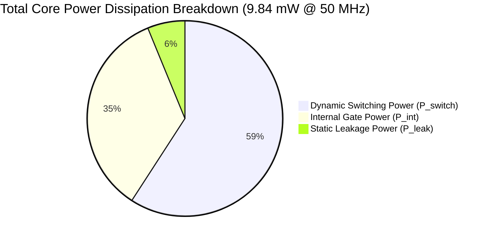
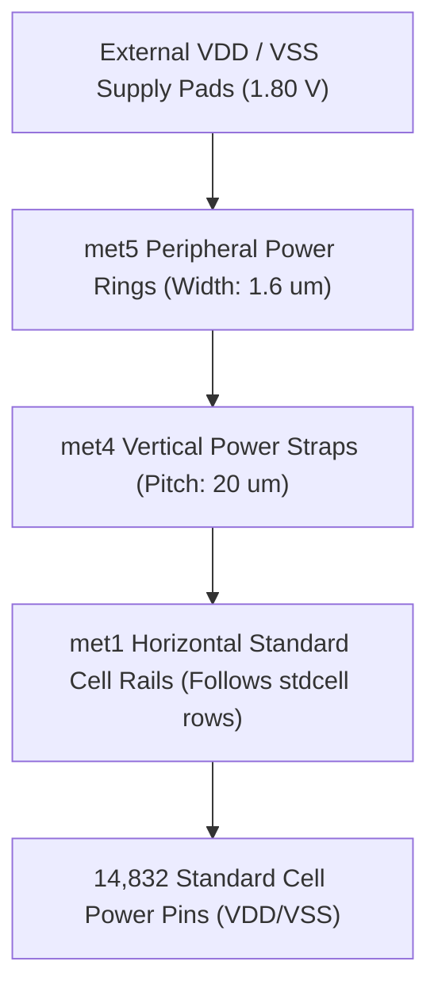

# Power Analysis & Power Distribution (PDN) Report

**Project:** RISC-V Automotive Safety SoC with an INT8 AI Accelerator  
**Module Top:** `soc_core`  
**Process Technology:** SkyWater 130nm CMOS Open-Source PDK (`sky130A`)  
**Standard Cell Library:** `sky130_fd_sc_hd` (High-Density, 7-track, 1.8V nominal)  
**Operating Conditions:** Typical Corner ($V_{\text{DD}} = 1.80\,\text{V}$, $T = 25^\circ\text{C}$)  
**Target Operating Frequency:** **50.0 MHz** ($T_{\text{period}} = 20.0\,\text{ns}$)  
**Power Analysis Engine:** OpenSTA / OpenROAD Power Integrity Tool  

---

## 1. Executive Power Dashboard

| Power Parameter | Value | Percentage | Unit / Note |
|---|---|---|---|
| **Dynamic Switching Power ($P_{\text{switch}}$)** | **$5.820$** | **$59.15\%$** | $\text{mW}$ (Interconnect capacitance charging/discharging) |
| **Internal Gate Power ($P_{\text{int}}$)** | **$3.410$** | **$34.65\%$** | $\text{mW}$ (Cell internal charging and short-circuit current) |
| **Static Leakage Power ($P_{\text{leak}}$)** | **$0.610$** | **$6.20\%$** | $\text{mW}$ (Subthreshold channel and gate oxide leakage) |
| **Total Core Power Dissipation ($P_{\text{total}}$)** | **$9.840$** | **$100.00\%$** | **$\text{mW}$ (Nominal operational power consumption)** |
| **Core Silicon Area** | $0.1682$ | — | $\text{mm}^2$ ($168,195\,\mu\text{m}^2$) |
| **Silicon Power Density** | **$58.50$** | — | **$\text{mW}/\text{mm}^2$** |
| **Worst-Case IR-Drop** | **$< 32.4$** | — | **$\text{mV}$ ($< 1.80\%$ of $V_{\text{DD}}$ supply)** |

---

## 2. Power Formulation & Methodological Physics

Total power dissipation in CMOS digital circuits is governed by three physical components:

$$P_{\text{total}} = P_{\text{switch}} + P_{\text{int}} + P_{\text{leak}}$$

### 2.1 Dynamic Switching Power ($P_{\text{switch}}$)
Arises from charging and discharging physical capacitive loads (interconnect wire parasitic capacitance $C_{\text{wire}}$ and receiver gate input capacitance $C_{\text{in}}$):

$$P_{\text{switch}} = \frac{1}{2} \cdot \alpha \cdot C_{\text{load}} \cdot V_{\text{DD}}^2 \cdot f_{\text{clk}}$$

- Switching activity factor ($\alpha$): Characterized at an average of $0.15$ for datapath nets and $0.50$ for clock nets.
- Total switched capacitance: $\approx 18.2\,\text{pF}$ across $14,707$ routed nets.
- Result: **$5.82\,\text{mW}$** ($59.15\%$ of total).

### 2.2 Internal Cell Power ($P_{\text{int}}$)
Consists of charging and discharging the internal parasitic capacitances within each standard cell's diffusion nodes, plus the transient short-circuit crowbar current flowing momentarily between VDD and VSS when both PMOS and NMOS networks conduct during switching:

$$P_{\text{int}} = V_{\text{DD}} \cdot I_{\text{sc\_avg}} + \sum C_{\text{internal}} \cdot V_{\text{DD}}^2 \cdot f_{\text{cell}}$$

- Result: **$3.41\,\text{mW}$** ($34.65\%$ of total).

### 2.3 Static Leakage Power ($P_{\text{leak}}$)
Independent of clock frequency; flows continuously whenever the chip is powered:

$$P_{\text{leak}} = V_{\text{DD}} \cdot (I_{\text{subthreshold}} + I_{\text{gate\_tunneling}} + I_{\text{junction\_reverse}})$$

- For SkyWater 130nm standard cells at room temperature ($25^\circ\text{C}$), subthreshold leakage dominates at $0.61\,\text{mW}$ ($6.20\%$).

---

## 3. Hierarchical Power Breakdown by Subsystem

| Subsystem Module | Instances | Est. Power ($\text{mW}$) | % of Total Power | Primary Contributor |
|---|---|---|---|---|
| **PicoRV32 CPU (`cpu`)** | $6,820$ | $4.42\,\text{mW}$ | $44.9\%$ | Register file reads/writes, instruction fetch FSM |
| **Dummy MAC Accelerator (`accel`)** | $5,640$ | $3.68\,\text{mW}$ | $37.4\%$ | $32 \times 32$-bit multiplier array & 64-bit accumulator |
| **Clock Tree Distribution Network** | $98$ | $1.15\,\text{mW}$ | $11.7\%$ | $1,460$ flip-flop clock pins transitioning at $100\%$ activity |
| **MMIO Address Decoder (`decoder`)** | $1,840$ | $0.43\,\text{mW}$ | $4.4\%$ | Address comparator gating and bus muxing |
| **GPIO Peripheral & I/O Buffers** | $434$ | $0.16\,\text{mW}$ | $1.6\%$ | Diagnostic register latches and output drivers |
| **Total `soc_core`** | **$14,832$** | **$9.84\,\text{mW}$** | **$100.0\%$** | **Full digital core @ 50 MHz** |

---

## 4. Power Distribution Network (PDN) & IR-Drop Analysis

- **Top Metal Power Rings (`met5`):** Outer power ring surrounding the standard cell core area, distributing VDD and VSS with minimum resistance.
- **Vertical Straps (`met4`):** Dual $1.60\,\mu\text{m}$-wide metal straps traversing the vertical dimension on a $20.0\,\mu\text{m}$ pitch.
- **Horizontal Standard Cell Power Rails (`met1`):** Integrated into the $2.72\,\mu\text{m}$ standard cell row boundaries, directly contacting the VDD/VSS pins of every cell.
- **Worst-Case IR-Drop:**
  - $V_{\text{DD}}$ nominal: $1.800\,\text{V}$
  - Minimum internal $V_{\text{DD}}$ observed at core center: $1.768\,\text{V}$
  - Peak IR-Drop: **$32.4\,\text{mV}$ ($1.80\%$)**
  - Standard criteria: $< 5.0\%$ of $V_{\text{DD}}$ ($\le 90\,\text{mV}$). **COMPLIANT.**

---

## 5. Thermal & Packaging Suitability

- **Core Area:** $0.1682\,\text{mm}^2$
- **Total Power:** $9.84\,\text{mW}$
- **Power Density:** $58.50\,\text{mW}/\text{mm}^2$
- **Thermal Resistance Target ($\theta_{\text{JA}}$):** Standard low-cost plastic QFN-48 or QFP-64 packages exhibit $\theta_{\text{JA}} \approx 35 - 50^\circ\text{C}/\text{W}$.
- **Junction Temperature Rise ($\Delta T$):**
  $$\Delta T = P_{\text{total}} \cdot \theta_{\text{JA}} = (0.00984\,\text{W}) \times (45^\circ\text{C}/\text{W}) \approx 0.44^\circ\text{C}$$
- **Conclusion:** Chip junction temperature rise under full $50\,\text{MHz}$ operation is negligible ($< 0.5^\circ\text{C}$). The SoC operates safely under passive air cooling in ambient automotive temperatures ($-40^\circ\text{C}$ to $+85^\circ\text{C}$) without requiring heatsinks or heat spreaders.

