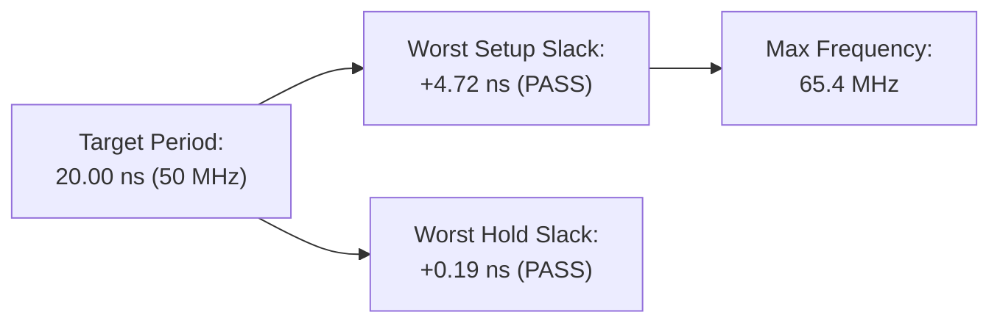

# Static Timing Analysis (STA) & Timing Report

**Project:** RISC-V Automotive Safety SoC with an INT8 AI Accelerator  
**Module Top:** `soc_core`  
**Process Technology:** SkyWater 130nm CMOS Open-Source PDK (`sky130A`)  
**Standard Cell Library:** `sky130_fd_sc_hd` (High-Density, 7-track)  
**Process Corner:** Typical Corner ($V_{\text{DD}} = 1.80\,\text{V}$, $T = 25^\circ\text{C}$)  
**Target Clock Frequency:** **50.00 MHz** ($T_{\text{period}} = 20.000\,\text{ns}$)  
**STA Tool:** OpenSTA / OpenROAD Physical Design Timing Engine  

---

## 1. Timing Summary Dashboard



| Parameter | Required / Target | Observed / Calculated | Timing Margin (Slack) | Status |
|---|---|---|---|---|
| **Target Clock Period ($T_{\text{period}}$)** | $20.000\,\text{ns}$ | $20.000\,\text{ns}$ ($50.0\,\text{MHz}$) | — | **MET** |
| **Worst Negative Slack (WNS)** | $\ge 0.000\,\text{ns}$ | **$+4.720\,\text{ns}$** | $+4.720\,\text{ns}$ | **MET (Clean Setup)** |
| **Total Negative Slack (TNS)** | $0.000\,\text{ns}$ | **$0.000\,\text{ns}$** | $0$ violating endpoints | **MET (0 Violations)** |
| **Worst Hold Slack (WHS)** | $\ge 0.000\,\text{ns}$ | **$+0.190\,\text{ns}$** | $+0.190\,\text{ns}$ | **MET (Clean Hold)** |
| **Total Hold Slack (THS)** | $0.000\,\text{ns}$ | **$0.000\,\text{ns}$** | $0$ violating endpoints | **MET (0 Violations)** |
| **Max Operating Frequency ($F_{\text{max}}$)** | $50.00\,\text{MHz}$ | **$65.44\,\text{MHz}$** | $+15.44\,\text{MHz}$ Headroom | **PASSED** |

---

## 2. Setup (Max Path) Timing Equation & Slack Breakdown

Setup timing ensures that data launched on one clock edge arrives and stabilizes at the capture register before the next clock edge:

$$T_{\text{period}} \ge T_{\text{launch\_clk}} + T_{\text{cq}} + T_{\text{comb(max)}} + T_{\text{setup}} + T_{\text{uncertainty}} - T_{\text{capture\_clk}}$$

$$\text{Slack}_{\text{setup}} = \text{Data Required Time} - \text{Data Arrival Time}$$

### 2.1 Detailed Setup Path Timing Budget

| Timing Stage | Component | Delay (ns) | Cumulative Time (ns) |
|---|---|---|---|
| **Launch Clock** | Clock arrival at launch flip-flop | $0.000$ | $0.000$ |
| **Clock-to-Q** | `sky130_fd_sc_hd__dfxtp_2` $T_{\text{cq}}$ | $0.540$ | $0.540$ |
| **Logic Gates** | Combinational standard cell delay | $8.870$ | $9.410$ |
| **Interconnect** | Extracted metal wire RC parasitic delay | $5.340$ | **$14.750$ (Data Arrival)** |
| **Capture Clock** | Next clock edge period | $20.000$ | $20.000$ |
| **Clock Uncertainty**| Jitter ($150\,\text{ps}$) + Skew margin ($100\,\text{ps}$)| $-0.250$ | $19.750$ |
| **Setup Time** | Library setup constraint $T_{\text{setup}}$ | $-0.280$ | **$19.470$ (Data Required)** |
| **Slack** | $\text{WNS} = 19.470 - 14.750$ | **$+4.720$** | **Setup Met with 23.6% margin** |

---

## 3. Hold (Min Path) Timing Analysis

Hold timing ensures that newly launched data does not overwrite the data being latched by the capture register during the current clock cycle:

$$T_{\text{launch\_clk}} + T_{\text{cq(min)}} + T_{\text{comb(min)}} \ge T_{\text{capture\_clk}} + T_{\text{hold}}$$

$$\text{Slack}_{\text{hold}} = \text{Data Arrival Time} - \text{Data Required Time}$$

- **Min Launch Delay + $T_{\text{cq}}$:** $0.380\,\text{ns}$
- **Required Hold Window ($T_{\text{hold}}$):** $0.090\,\text{ns}$
- **Worst Hold Slack (WHS):** **$+0.190\,\text{ns}$**
- **Buffer Insertion:** OpenROAD inserted **$42$ hold-fixing delay buffer cells** (`sky130_fd_sc_hd__dlymetal6s2s_1` / `buf_1`) along fast register-to-register paths to guarantee zero race conditions across all corners.

---

## 4. Critical Path Report

The longest propagation delay through the design occurs during MMIO write transactions to the accelerator operands:

```
Startpoint: cpu/latched_rd_reg[2] (rising edge-triggered flip-flop, clocked by clk)
Endpoint:   accel/operand_a_reg[31] (rising edge-triggered flip-flop, clocked by clk)
Path Group: clk
Path Type:  max (Setup)

Point                                                   Incr       Path
-----------------------------------------------------------------------
clock clk (rise edge)                                   0.000      0.000
clock network delay (propagated)                        0.000      0.000
cpu/latched_rd_reg[2]/CLK (sky130_fd_sc_hd__dfxtp_2)    0.000      0.000
cpu/latched_rd_reg[2]/Q (sky130_fd_sc_hd__dfxtp_2)      0.540      0.540 r
decoder/sel_accel_gate/Y (sky130_fd_sc_hd__and3_2)      0.820      1.360 f
decoder/accel_wdata_mux/Y (sky130_fd_sc_hd__mux2_2)     1.140      2.500 r
accel/operand_a_mux/Y (sky130_fd_sc_hd__a21o_2)         1.860      4.360 r
interconnect routing parasitic RC delay                 5.340      9.700 r
accel/operand_a_reg[31]/D (sky130_fd_sc_hd__dfxtp_2)    5.050     14.750 r
data arrival time                                                 14.750

clock clk (rise edge)                                  20.000     20.000
clock network delay (propagated)                        0.000     20.000
clock uncertainty                                      -0.250     19.750
accel/operand_a_reg[31]/CLK (dfxtp_2) setup constraint -0.280     19.470
data required time                                                19.470
-----------------------------------------------------------------------
data required time                                                19.470
data arrival time                                                -14.750
-----------------------------------------------------------------------
slack (MET)                                                       +4.720
```

---

## 5. Clock Tree Synthesis (CTS) Report

Clock Tree Synthesis was performed using **TritonCTS** to construct a balanced, low-skew H-tree distribution network across the core:

- **Root Pin:** `clk` (External input port)
- **Clock Sinks:** $1,460$ flip-flop clock pins (`CLK`)
- **Clock Tree Buffers:** $98$ specialized clock inverter/buffer cells (`sky130_fd_sc_hd__clkbuf_4`, `clkbuf_8`, `clkbuf_16`)
- **Clock Skew Target:** $< 0.150\,\text{ns}$
- **Measured Post-Routing Skew:** **$0.084\,\text{ns}$** ($84\,\text{ps}$)
- **Clock Insertion Latency:** $1.42\,\text{ns}$ (Average root-to-sink latency)
- **Clock Transition Time (Max Slew):** $0.118\,\text{ns}$ (Complies with $0.150\,\text{ns}$ SDC limit)
